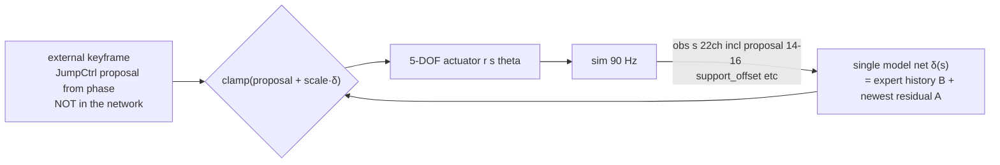
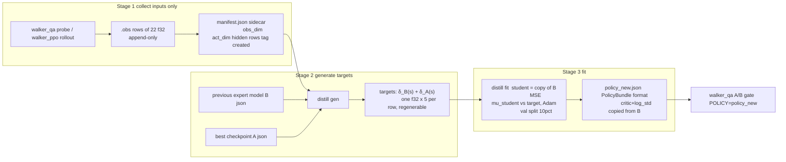
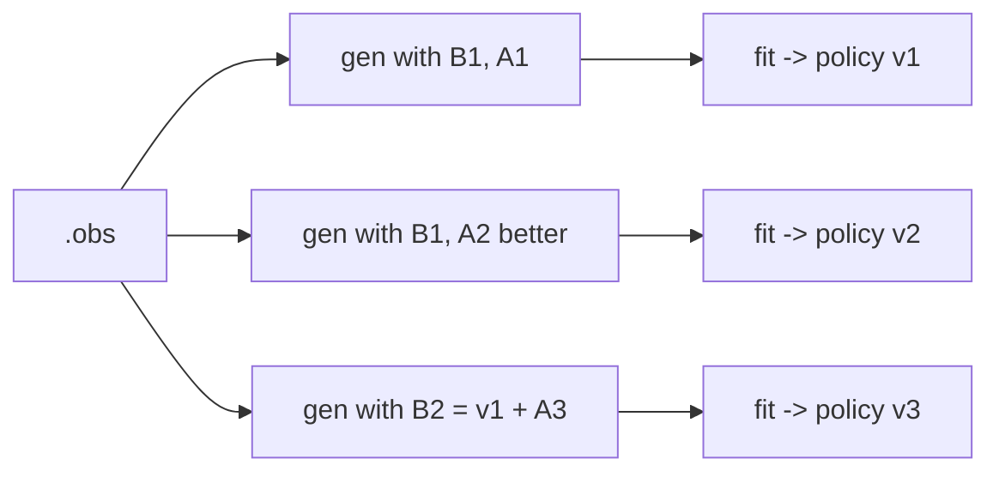

# Distill to a single accumulating model (residual on an external keyframe)

Status: **v1 implemented** (dataset IO, `distill gen`/`fit`, `walker_qa`
`DUMP_OBS` collector, and the `walker_ppo` training-time rollout drain as the
**primary** collector; the behavioural gate is the pending acceptance step) ·
Area: `walker_nn` (new `distill` binary + dataset IO) with small hooks in
`walker_qa` / `walker_ppo` · Builds on
[`jump-ppo-residual-polar-action.md`](jump-ppo-residual-polar-action.md) (residual
on expert, obs 22 / act 5, hidden [64,64]) and the task-outcome reward in
[`walker_ppo/src/reward.rs`](../../walker_ppo/src/reward.rs).

## 0. Why this exists

RL cheats the reward after thousands of episodes. The mitigation is a
human-in-the-loop loop: train a constrained residual around the expert, curate
the best non-degenerate checkpoint, fold it back into the expert, patch the
reward where it was gamed. Folding back requires a *merge*. We cannot add
weights of two `tanh` MLPs (non-additive). We copy the **accepted residual
policy into the baseline** and let a fresh net learn the next increment, in
**function space** (two forwards summed) — never in weight space.

Additional requirement from the user: **more action families are coming**
(jump → walk → boost → …), and one model should master them all so the
handoff between skills is smooth rather than a policy swap. This doc covers the
**simple vertical-jump distill first**; the multi-action extension is section 8.

## 1. The architecture (confirmed)



- **The keyframe stays out of the model.** `JumpCtrl` owns the crouch→extend
  schedule; the net only emits the residual δ. This keeps the model shape
  constant from the very first generation — the user's explicit requirement —
  and the plan's obs already carries the proposal channels
  (`r_prop, s_prop, sin θ_prop`, indices 14–16), so the net *sees* the keyframe
  without owning it.
- **Two models at runtime become one at rest.** During a generation we keep the
  frozen baseline net `B` (the accumulated expert history) plus the newest
  residual net `A`. The composite authority is:
  ```
  δ_authority(s) = δ_B(s) + δ_A(s)        (both in the SAME residual frame)
  final_action(s) = clamp( proposal(s) + scale·δ_authority(s) )
  ```
  Both `δ_B` and `δ_A` are the *same semantic quantity* (residual on the
  proposal), so **function addition is valid** — this is the whole reason we
  keep the keyframe external. At every accepted promotion the pair is **distilled
  into one net** so deployment is always a single `policy.json`.
- **Merge = promotion, never weight-average.** On acceptance: `B ← A*`
  (functional), `A ←` fresh zero-init net. Mimick the residual policy's
  weights at *init*, but the distilled single net is produced by fitting, not
  by arithmetic.

## 2. The three-stage pipeline



Split rationale (user-confirmed): **collect inputs only**, because targets are a
pure function of `(B, A*, s)` — no physics. Storage is small (thousands of
rows × 22 f32); any historical input can be **relabelled with a newer
authority** (Section 6) without re-running the sim.

### Stage 1 — collector (inputs only)

Hook | Where | Notes
--- | --- | ---
`DUMP_OBS=<path.obs>` | `walker_ppo` (**primary**) | drained every PPO update from the in-memory rollout buffer, *before* the update trains on it — the exact obs vectors the composite (B+A) policy was fed that generation, bit-for-bit consistent with the checkpoint written at the same update (§7). This is the "sees every input ever fed" property, and it holds even for the reward-hacked mid-run states a probe would never reach.
`DUMP_OBS=<path.obs>` | `walker_qa` (complement) | every fixed tick, append the exact obs vector fed to the controller at that tick (post-normalization, in the `.obs` row layout). A scripted deploy probe; coverage is the on-support distribution of one script. Useful to thicken the data around a curated `A*` or to post-hoc verify a deployed policy.

Both reuse the same `.obs`/manifest writer ([`walker_nn/src/dataset.rs`](../../walker_nn/src/dataset.rs)), so the two sources merge into one dataset seamlessly.

Format:
- `<tag>.obs` — little-endian `f32`, `ROW = obs_dim` (22) per record, append-only.
- `<tag>.manifest.json` — `{ obs_dim, action_dim, hidden:[…], rows, tag, source, created_ts, replaced_by: null }`. If a dataset is superseded, `replaced_by` points at the newer tag (archive discipline, no in-place mutation).
- `<tag>.windows.csv` — `update,end_row` per drain (append-only): the file-row
  boundary at each update. Complementary cut mechanism for resumed/append-only
  runs (`distill --upto`); the primary per-checkpoint path below needs no slicing.

#### One input file per checkpoint

The trainer emits **one self-contained input file per checkpoint**, aligned to
the same `SNAPSHOT_EVERY` cadence as the indexed policy snapshots:

```text
<tag>_ckpt_NNNN.obs            copy of the stream-so-far at update N (rows 1..=N)
<tag>_ckpt_NNNN.manifest.json  rows = end_row at that update, tag = ckpt stem
```

`ckpt_0010.obs` holds updates 1..=10's obs **and nothing later** — the exact
rows the composite (B+A) policy was fed to produce `policy_0010` (drained
pre-update, snapped in the same generation). Picking checkpoint K means using
`<tag>_ckpt_NNNN.obs` directly; no slicing, no `--upto`.

#### The loop (as run) — collect from the *training* the new expert came from

1. Fresh `walker_ppo` run with `DUMP_OBS=tmp/distill/<tag>.obs`. The run cheats
   at the end (reward hacking is the expected failure for a still-growing
   reward); the **train-time drain** still captured every obs it saw along the
   way — including the cheating states.
2. Pick the best checkpoint (`tmp/walker_ppo/policy_best.json` / indexed
   `snap/policy_NNNN.json`) → this is `A*`. Because the checkpoint came from
   this very run, its `(obs, action)` history is exactly
   `tmp/distill/<tag>_ckpt_NNNN.obs`, already cut to that checkpoint — feed it
   straight to `gen`/`fit`.
3. Update the reward function to close the observed hack, keeping the picked
   checkpoint as part of the expert (`RESUME=policy_best.json`) for the next
   run, with `DUMP_OBS` writing the new tag. Course-correct with the metric
   gate (peak/lift-offs/landing), never `mean_ep_reward`.
4. Repeat until a clean `A*` exists **and** a dataset consistent with it does —
   then `gen`/`fit` (§2 below) have everything needed for the first distill.

### Stage 2 — generator (`distill gen`)

- Inputs: `--obs <tag>.obs`, `--expert <B policy.json>`, `--best <A policy.json>`, `--out <tag>.target` (and optional `--delta-max 1.0` clamp per dim, default off).
- For each row: `target = μ_B(s) + μ_A(s)` where μ is `act_deterministic` (pure forward). Load both bundles as `PolicyBundle`.
- Guard: `B.in_dim == A.in_dim == obs row len` and `B.actor.dims == student.dims`; error otherwise (the consistency invariant, Section 7).
- Output `f32[5]` per row, same row count as `.obs`. Because generation does not touch physics it is **instant and re-runnable**: choosing a different best checkpoint only reruns this step.

### Stage 3 — fitter (`distill fit`)

- Inputs: `--obs`, `--targets` (or `--out` from gen), `--expert B`, `--epochs K` (default 8, mirroring PPO's `epochs`), `--lr` (default 3e-4), `--val-frac 0.1`, optional `--jitter 0.01` (support thickening: replicate rows with small p.d.-scale noise).
- **Student init = deep clone of `B`'s actor weights** — it already knows the previous expert history; the fit only has to learn the small `A` addition, so 1–2 epochs is often enough (this is the re-anchor, in distill form).
- Loss: MSE over the actor output head only. Optimizer: the existing `Adam` ([`adam.rs`](../../walker_nn/src/adam.rs)); reuse `Mlp::get_params/set_params`.
- Keep `B`'s `critic` and `log_std` (deploy uses `act_deterministic` only; `RESUME` rebuilds the critic buffer from the loaded config — copying is safe).
- Outputs: `policy_new.json` in the same serialized shape `PolicyBundle::load_json` accepts (tested cross-format with trainer json, [`bundle.rs` validation] — we write the *same* struct), plus `distill_report.csv` (train/val MSE per epoch, rows, val split indices) and a one-line summary.
- Report val MSE and a `pass` flag against a configurable threshold; the *behavioural* gate is the next step, not this number.

### Gate — behavioural A/B (unchanged harness)

`walker_qa` with `POLICY=tmp/walker_ppo/distill/policy_new.json`, fixed script
(`plans/walker_jump_hop_script.json`), `RUN_WIN=0` for screen + the existing
summary (peak height, single lift-off count, landing verdict, grounded
fraction, foot margin). Compare against the composite `(B+A)` running as today
(`EXPERT_ONLY`/`RESUME` path). **The gate, not the val MSE, decides
promotion.** On regress: revert to the last accepted `B` (archive) and rerun.

## 3. Exact formulas and invariants

```text
δ_B(s)   = μ_B(s)                      # previous expert model's deterministic residual
δ_A(s)   = μ_A(s)                      # best checkpoint's deterministic residual
target   = δ_B(s) + δ_A(s)             # valid because both live in the residual frame
final    = clamp( proposal(s) + scale * δ(s) )   # scale = per-dim σ_scale from JumpResidualConfig
```

Invariants (assert at every stage boundary):
1. `obs_dim == 22 == bundle.in_dim` and `action_dim == 5 == bundle.out_dim`.
2. Student `actor.dims == B.actor.dims` (identity of shape across generations ⇒
   "model consistent from start").
3. The collected row is the **exact vector** `build_obs` produced (same
   normalizers `v_scale 200`, `omega_scale 6`, `hip_height 104`) — a mismatch
   here silently rewires the input space.
4. Targets are regenerable: `(obs, B, A)` ⇒ `target`, no hidden state.

## 4. File layout

```text
tmp/distill/
  <tag>.obs               f32 LE rows of 22 (append-only stream)
  <tag>.manifest.json     metadata sidecar
  <tag>_ckpt_NNNN.obs     self-contained input per checkpoint (rows 1..=N)
  <tag>_ckpt_NNNN.manifest.json
  <tag>.windows.csv       update,end_row boundaries (resume/--upto complement)
  <tag>.target            f32 LE rows of 5 (generated; deletable/regenerable)
  policy_new.json         distilled single model (PolicyBundle format)
  distill_report.csv      per-epoch MSE
walker_nn/src/bin/distill.rs        gen + fit subcommands (no bevy)
walker_nn/src/dataset.rs            .obs IO + manifest + windows
```

## 5. Reusable building blocks (already in the repo)

- `Mlp::forward_cache` / `backward`, `Mlp::new(dims)` ([`mlp.rs`](../../walker_nn/src/mlp.rs)) — the fitter needs forward + `get_params/set_params`.
- `Adam` ([`adam.rs`](../../walker_nn/src/adam.rs)) — weights + moments.
- `PolicyBundle` load/save + `act_deterministic` ([`bundle.rs`](../../walker_nn/src/bundle.rs)) — gen reads `A`, `B`; fit writes the student in the same shape walker_qa reads.
- Headless probe runs + telemetry ([`walker_qa`](../../walker_qa/src/main.rs), `run_walker_qa.sh`) — the gate and the collector hook site.
- `DEPLOY = EXPERT_ONLY` / `RESUME=` path in `walker_ppo` — used to curate which checkpoint is `A*` (already keyed on `mean_peak_height`, not `mean_ep_reward`).

## 6. Regenerable targets (the payoff)

Because Stage 1 stores only inputs, the whole loop replays cheaply:



No new simulation when a better checkpoint appears or when a reward patch
changes which checkpoint is best — only two forwards per row.

## 7. Consistency guarantees

- Single deployable `policy_new.json`; the net's dims never change across a
  promotion, so `walker_qa POLICY=` and `walker_ppo RESUME=` load any generation
  unchanged.
- The keyframe is external forever ⇒ adding a new action family later
  (Section 8) does not touch the jump residual's contract.

## 8. Roadmap: toward one model, many skills (future, not this milestone)

- Add a `mode` one-hot channel to the obs and a **shared trunk + per-skill
  head**. Copying old heads is an *exact* merge for the old dims (no fit needed
  for unchanged behaviour) — the structural case where "no data" distillation is
  valid.
- Replay archive: keep `(obs → μ_expert)` pairs of settled skills; on training a
  new skill mix replayed old-skill targets so the trunk doesn't forget
  (catastrophic forgetting defense). This is why the collector is built generic
  (any tag, any skill) from day one.
- The gate then must evaluate **every** skill on every review, not just the new
  one.
- Rejected: weight-averaging two policies (non-additive `tanh`); "reward maps
  exactly to action" as a goal (equivalent to writing the controller).

## 9. Milestone checklist (jump distill only)

- [x] `walker_nn` dataset module: `.obs`/`.target` read/write, manifest sidecar, round-trip test.
- [x] `walker_nn/src/bin/distill.rs` with `gen` and `fit` subcommands + inline tests.
  - [x] `gen`: load two bundles, `target = μ_B + μ_A`, dim guards, rewrite-stable output.
  - [x] `fit`: student = clone of B; MSE + Adam over actor; val split; report; write `policy_new.json` + `distill_report.csv`.
- [x] `walker_qa` `DUMP_OBS=<path>` hook (append the exact obs vector per fixed tick) + env-forwarding in `run_walker_qa.sh` (no new flags; live-verified: 225 rows with a matching manifest).
- [x] `walker_ppo` training-time rollout drain (`DUMP_OBS=<path.obs>`): every PPO update, append the rollout's obs rows before the update trains on the same buffer, plus the manifest sidecar (source `walker_ppo rollout drain`). The dataset is bit-for-bit consistent with the checkpoints written at the same updates — the primary collector; the `walker_qa` probe stays as a complementary sampler.
- [x] Per-checkpoint input files: at each `SNAPSHOT_EVERY` update the drain copies the stream-so-far to `<tag>_ckpt_NNNN.obs` with its own manifest — one self-contained input file per checkpoint, so choosing a checkpoint needs no slicing. `<tag>.windows.csv` (`update,end_row`, per drain) + `distill --upto <update>` remain as the complementary cut path for resumed/append-only runs.
- [x] Unit tests: `.obs` round-trip; gen determinism on dummy bundles; fit converges on a synthetic `(s → δ_B+δ_A)` pair; produced `policy_new.json` loads as `PolicyBundle` and `μ` matches targets on the val split.
- [ ] Behavioural gate run: `walker_qa POLICY=policy_new.json` vs composite; record peak/lift-offs/landing/grounded — *acceptance step, requires a real `A*` checkpoint*.
- [x] Docs: `tools/physics-qa/README.md` usage + this plan marked implemented.

## 10. Risks and mitigations

| risk | mitigation |
| --- | --- |
| student drifts off the teacher's support (compounding error) | noise-thickened rows (jitter); behavioural gate in `walker_qa`; DAgger-lite one-pass if the gate regresses |
| obs normalization mismatch between collection and deploy | invariant 3 + single `build_obs` used by both; assert `obs_dim` |
| distilling a gamed checkpoint into the expert | promotion only via the metric gate (peak height, lift-offs, landing), never `mean_ep_reward` |
| accidental weight-merge | design forbids it; fit-only merge; unit test asserts `policy_new.actor.dims == B.actor.dims` and that `μ_new ≈ μ_B + μ_A` on hold-out |
| future skill forgetting | replay archive + structural head-copy (Section 8) |