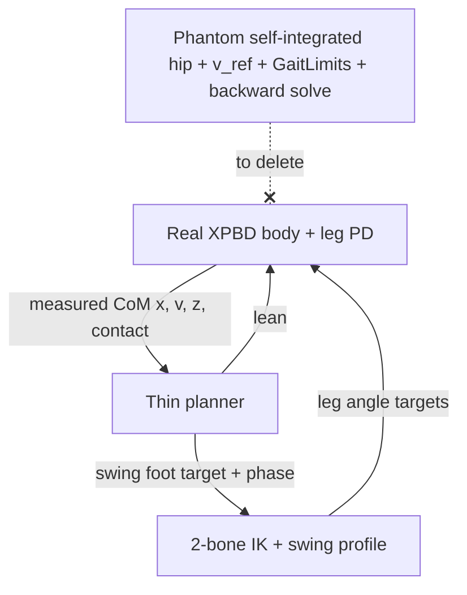

# Planner rewrite: drop the kinematic sandbox, keep three loops

Goal (from the user): the gait is "pretty simple" in theory — **DCM foot
placement + the two Raibert loops** — and the codebase has accreted a
self-simulating *sandbox* that the real XPBD physics has quietly replaced.
Code we cannot maintain is worse than broken code, so the sandbox remnants get
cut. This document is the design pass that precedes any deletion.

## Why it got complicated (root cause)

[`resolver.rs`](../examples/game_lib/src/lower_body/resolver.rs) still describes
itself as *"Pure … kinematic, no XPBD."* Historically the resolver WAS the
whole sim: it integrated its own hip (`hip_pos.x += v·dt`), shaped its own
reference velocity (`v_ref`, `a_eff`, `GaitLimits`), predicted landings, and ran
a backward solve to correct its own velocity. XPBD was bolted on afterwards and
`feedback` began overwriting the sandbox hip with the measured P3
([`drive.rs:74`](../examples/game_lib/src/lower_body/hip_pin/drive.rs:74)).

So today there are **two bodies**:
1. the *real* one (XPBD particles + leg PD) that actually walks the character, and
2. a *phantom* one the resolver integrates and self-corrects.

Almost all the complexity is bookkeeping for body #2. The honest planner has one
job: **decide where the next foot goes and when to lift**, then hand poses to the
leg PD. Loops:
- **Loop 1 (balance / placement):** read measured CoM → DCM `ξ = x + v/ω₀` → foot
  target `p`. This is the only "decision".
- **Loop 2 (height):** leg PD holds hip height against the floor. (Open question
  whether the resolver's vertical *model* survives — see Scope.)
- **Loop 3 (attitude):** torso lean PD, delivered via `upright_reference_lean`.

## Inventory of the sandbox machinery (candidate deletions)

| Cluster | Files/symbols | Status | Risk if removed naively |
|---|---|---|---|
| Internal hip integration | `walk.rs` `hip_pos.x += v*dt` | phantom | tests + `feedback` both read `hip_pos.x`; removal changes units/frames |
| Velocity shaping | `v_ref`, `approach`, `a_cmd/a_eff`, `v_ceil` | phantom (body obeys real forces) | but `v_ref` is ALSO the servo target handed to `delta_frame_targets` — not pure phantom |
| Feasibility envelope | `GaitLimits`, `compute_v_max`, `a_max`, `v_abs`, `v_plan_cap` | phantom | guards the documented "floating foot" bug |
| Backward solve | `compute_support_velocity`, `kv`, `beta`, `td_solve_floor`, `apply_support_floor` | phantom | converts landing error→velocity; only meaningful because body is soft |
| Placement-law fallback chain | deadbeat → gain → horizon → Raibert (4 deep) | dead knobs (`DCM_KP`,`MPC_TRIGGER`) | pick ONE law (Scope) |
| Stop-settle servo | `walk.rs` §4 midpoint glide | phantom | drives `v`/`hip_pos` it no longer owns |

## Keep (these each guard a real, documented regression)

- **Phase FSM** (`stance→swing→plant`, anti-phase `other_swinging`) —
  [`stepping.rs`](../examples/game_lib/src/lower_body/resolver/stepping.rs).
- **Reach clamp `hip ± x_max` + `capture_saturated`** — IK singularity guard
  (`LIFT_REACH_SAFE_FRACTION`), the floating-foot bug.
- **Contact-driven plant re-anchor** (`plant_anchored`, `lost_contact_early`) —
  §6 authority; keeps plan honest to where the foot actually landed.
- **Swing C¹ profile** (`swing_profile_foot`) — touchdown-kick regression.
- **`feedback` P3→hip remap + `delta_frame_targets`** — the only real coupling.

## Scope decisions (block implementation until answered)

1. **Loop 2 / vertical.** `regulate_height` self-integrates `hip_pos.y` — pure
   sandbox — BUT the leg PD consumes `thrust.stance_extend/flight_retract` for
   jump/load/land/crouch. Options: (a) keep the vertical FSM as the *command
   source* but stop integrating a phantom y; (b) gut vertical entirely, height is
   100% the leg PD (jump becomes a leg-PD impulse); (c) keep as-is for now.
2. **Single placement law.** ⚠️ See "law discrepancy" below — this is unresolved
   and gates every deletion in `placement.rs`/`laws.rs`.
3. **No-measurement fallback.** Unit tests run the resolver without XPBD
   (`state.measured = None` → Raibert neutral point). Does a no-physics test mode
   survive, or do gait tests move onto the harness (`run_walk.sh`)?

## Law discrepancy (must resolve first)

The user's intent: `DCM_TC = 0` (auto → `t_c = T_stance`) so the **analytic
deadbeat** law runs. The math doc [`dcm-prediction-math.md`](dcm-prediction-math.md)
argues the deadbeat *is* the correct law and the horizon form is a truncation with
a zero-lead cruise bug.

But the shipped default is the opposite:

| | value | effect |
|---|---|---|
| struct default `dcm_tc` | `-1.0` | deadbeat OFF |
| `run_walk.sh` | does not export `DCM_TC` | deadbeat OFF in the QA run |
| → live placement law today | — | `capture_point_with_horizon` (`p = ξ − v_des/(T_conv·ω₀)`) |

So **the walk we have been calling "approximately working" runs the horizon law**,
not the deadbeat the design blesses. Two different claims of "what holds it up":

- (A) Horizon holds it up, deadbeat was tried and the doc's own measurement table
  (`t_c=0.15` best, but default auto=`t_c=0.28`) never shipped. Then horizon is
  load-bearing and deadbeat is the deletable experimental branch.
- (B) The intended, correct law is deadbeat and the `-1.0` default is a stale
  bug; the walk "approximately works" *despite* the zero-lead pathology. Then the
  rewrite should flip the default to `0` and delete the horizon/Raibert fallbacks.

**Action before deletion:** run `run_walk.sh` with `DCM_TC=0` explicit and compare
the CSV/gates to the `-1.0` baseline just captured (`walk_removed`). Whichever law
gives better net progress / fewer gate failures is the one to keep; the other and
its env knob get deleted. Do not delete `capture_point_with_horizon` (or the
deadbeat) until that A/B is decided.

## Proposed execution order (after scope is locked)

1. Lock scope (the three answers above) → update this doc.
2. Delete provably-dead knobs first (`DCM_KP`, `MPC_TRIGGER`), prove identical CSV
   via `run_walk.sh` (behavior-neutral gate).
3. Collapse placement law to the chosen single form.
4. Replace phantom horizontal velocity/shaping with measured CoM passthrough.
5. Rework Loop 2 per the scope answer.
6. Trim `GaitLimits`/backward solve to only the live terms.
7. Update `params.rs` env surface + tests; re-run `cargo test -p game_lib --lib`
   and `run_walk.sh` at every step; the QA gates are the regression net.

## Validation contract

- Every "cleanup" step MUST leave `tmp/headless/walks/<tag>.csv` byte-identical
  unless it is an intentional behavior change approved in advance.
- `run_walk.sh <tag>` is the acceptance harness (visual pipeline = the on-screen
  graph; gates: NO_ADVANCE/NO_OVERTAKE/NO_LEAD_GAIN, foot-slide, rigidity).
