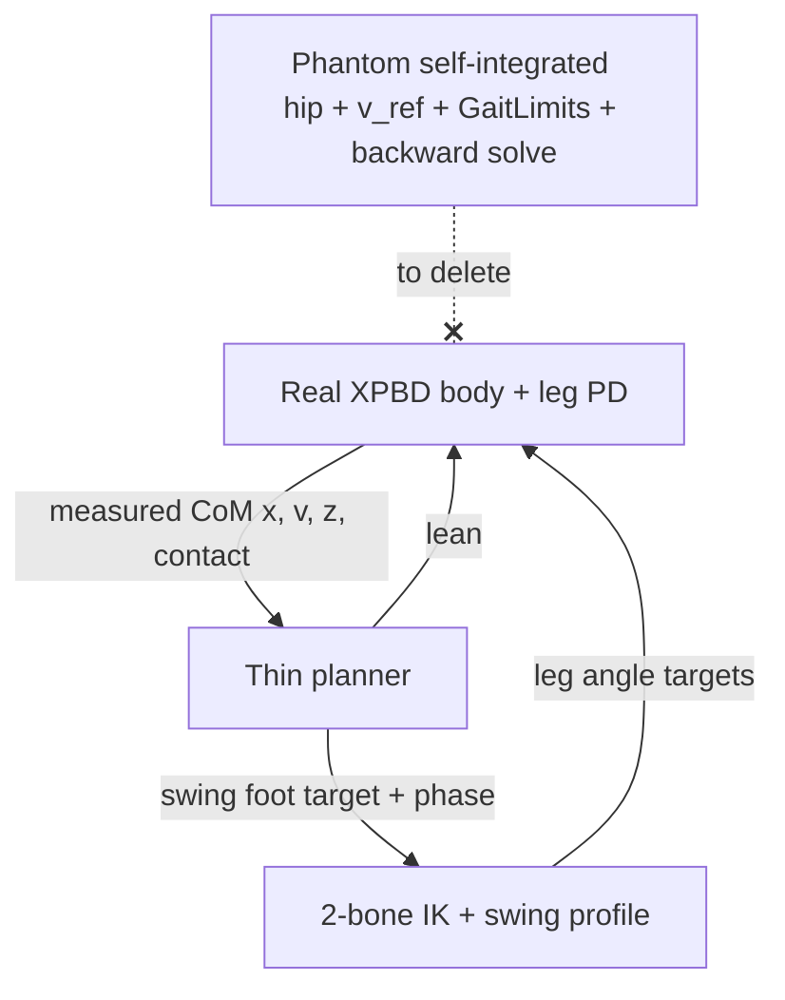

# Planner rewrite: drop the kinematic sandbox, keep three loops

Goal (from the user): the gait is "pretty simple" in theory — **DCM foot
placement + the two Raibert loops** — and the codebase has accreted a
self-simulating *sandbox* that the real XPBD physics has quietly replaced.
Code we cannot maintain is worse than broken code, so the sandbox remnants get
cut. This document is the design pass that precedes any deletion.

## Why it got complicated (root cause)

[`resolver.rs`](../examples/game_lib/src/lower_body/resolver.rs) still describes
itself as *"Pure … kinematic, no XPBD."* Historically the resolver WAS the
whole sim: it integrated its own hip (`hip_pos.x += v·dt`), shaped its own
reference velocity (`v_ref`, `a_eff`, `GaitLimits`), predicted landings, and ran
a backward solve to correct its own velocity. XPBD was bolted on afterwards and
`feedback` began overwriting the sandbox hip with the measured P3
([`drive.rs:74`](../examples/game_lib/src/lower_body/hip_pin/drive.rs:74)).

So today there are **two bodies**:
1. the *real* one (XPBD particles + leg PD) that actually walks the character, and
2. a *phantom* one the resolver integrates and self-corrects.

Almost all the complexity is bookkeeping for body #2. The honest planner has one
job: **decide where the next foot goes and when to lift**, then hand poses to the
leg PD. Loops:
- **Loop 1 (balance / placement):** read measured CoM → DCM `ξ = x + v/ω₀` → foot
  target `p`. This is the only "decision".
- **Loop 2 (height):** leg PD holds hip height against the floor. (Open question
  whether the resolver's vertical *model* survives — see Scope.)
- **Loop 3 (attitude):** torso lean PD, delivered via `upright_reference_lean`.



## Inventory of the sandbox machinery (candidate deletions)

| Cluster | Files/symbols | Status | Risk if removed naively |
|---|---|---|---|
| Internal hip integration | `walk.rs` `hip_pos.x += v*dt` | phantom | tests + `feedback` both read `hip_pos.x`; removal changes units/frames |
| Velocity shaping | `v_ref`, `approach`, `a_cmd/a_eff`, `v_ceil` | phantom (body obeys real forces) | but `v_ref` is ALSO the servo target handed to `delta_frame_targets` — not pure phantom |
| Feasibility envelope | `GaitLimits`, `compute_v_max`, `a_max`, `v_abs`, `v_plan_cap` | phantom | guards the documented "floating foot" bug |
| Backward solve | `compute_support_velocity`, `kv`, `beta`, `td_solve_floor`, `apply_support_floor` | phantom | converts landing error→velocity; only meaningful because body is soft |
| Placement-law fallback chain | deadbeat → gain → horizon → Raibert (4 deep) | dead knobs (`DCM_KP`,`MPC_TRIGGER`) | pick ONE law (Scope) |
| Stop-settle servo | `walk.rs` §4 midpoint glide | phantom | drives `v`/`hip_pos` it no longer owns |

## Keep (these each guard a real, documented regression)

- **Phase FSM** (`stance→swing→plant`, anti-phase `other_swinging`) —
  [`stepping.rs`](../examples/game_lib/src/lower_body/resolver/stepping.rs).
- **Reach clamp `hip ± x_max` + `capture_saturated`** — IK singularity guard
  (`LIFT_REACH_SAFE_FRACTION`), the floating-foot bug.
- **Contact-driven plant re-anchor** (`plant_anchored`, `lost_contact_early`) —
  §6 authority; keeps plan honest to where the foot actually landed.
- **Swing C¹ profile** (`swing_profile_foot`) — touchdown-kick regression.
- **`feedback` P3→hip remap + `delta_frame_targets`** — the only real coupling.

## Scope decisions (block implementation until answered)

1. **Loop 2 / vertical.** `regulate_height` self-integrates `hip_pos.y` — pure
   sandbox — BUT the leg PD consumes `thrust.stance_extend/flight_retract` for
   jump/load/land/crouch. Options: (a) keep the vertical FSM as the *command
   source* but stop integrating a phantom y; (b) gut vertical entirely, height is
   100% the leg PD (jump becomes a leg-PD impulse); (c) keep as-is for now.
2. **Single placement law.** ⚠️ See "law discrepancy" below — this is unresolved
   and gates every deletion in `placement.rs`/`laws.rs`.
3. **No-measurement fallback.** Unit tests run the resolver without XPBD
   (`state.measured = None` → Raibert neutral point). Does a no-physics test mode
   survive, or do gait tests move onto the harness (`run_walk.sh`)?

## Law discrepancy (must resolve first)

The user's intent: `DCM_TC = 0` (auto → `t_c = T_stance`) so the **analytic
deadbeat** law runs. The math doc [`dcm-prediction-math.md`](dcm-prediction-math.md)
argues the deadbeat *is* the correct law and the horizon form is a truncation with
a zero-lead cruise bug.

But the shipped default is the opposite:

| | value | effect |
|---|---|---|
| struct default `dcm_tc` | `-1.0` | deadbeat OFF |
| `run_walk.sh` | does not export `DCM_TC` | deadbeat OFF in the QA run |
| → live placement law today | — | `capture_point_with_horizon` (`p = ξ − v_des/(T_conv·ω₀)`) |

So **the walk we have been calling "approximately working" runs the horizon law**,
not the deadbeat the design blesses. Two different claims of "what holds it up":

- (A) Horizon holds it up, deadbeat was tried and the doc's own measurement table
  (`t_c=0.15` best, but default auto=`t_c=0.28`) never shipped. Then horizon is
  load-bearing and deadbeat is the deletable experimental branch.
- (B) The intended, correct law is deadbeat and the `-1.0` default is a stale
  bug; the walk "approximately works" *despite* the zero-lead pathology. Then the
  rewrite should flip the default to `0` and delete the horizon/Raibert fallbacks.

**Action before deletion:** run `run_walk.sh` with `DCM_TC=0` explicit and compare
the CSV/gates to the `-1.0` baseline just captured (`walk_removed`). Whichever law
gives better net progress / fewer gate failures is the one to keep; the other and
its env knob get deleted. Do not delete `capture_point_with_horizon` (or the
deadbeat) until that A/B is decided.

**RESOLVED 2026-10-28 (user decision, option B):** the deadbeat law is the one
shipped placement law. `capture_point_with_horizon` and `capture_point_with_gain`
(and the `t_conv`/`dcm_kp` fields, the `DCM_KP` env knob, and the
`test_dcm_kp_gain_form_keeps_cruise_lead` test) are DELETED; the struct default
`dcm_tc` is now `0` (auto = stance duration), so deadbeat is live by default.
The chain collapses to: `stopping` branch → deadbeat → Raibert neutral point
(only when `state.measured == None`, i.e. the pure-kinematic sandbox/tests).
The truncations survive only as the `t_c → ∞` / `t_c → 0` limit assertions in
`test_deadbeat_placement_is_the_exact_solution`.

## Placement spec: propagated deadbeat (rewrite target, 2026-10-28)

The shipped law re-plans a **receding deadline** every swing frame:
`t_c` is re-anchored to "now", so the mid-swing targets promise `v_des`
at `now + T_stance`, but the foot cannot start pivoting until touchdown —
only the FINAL frame's target is honest (and it is the one actually
planted, `plant_pos = swing_to`). The correct per-frame law separates
the two clocks (discussion of 2026-10-28):

- `t_r` = remaining flight time = the LIVE pivot's (stance foot's)
  remaining ground window. Its only valid use: propagate the state to
  touchdown over that pivot.
- `T_stance` = the swing foot's OWN first ground window after landing.
  Its only valid use: the coefficient schedule `(α, β)` of the new
  foot's push. NOT next step's parameter — this foot's effect window.

Per swing tick (all inputs live measurements):

```text
ω₀ = √(g/z_com),  ξ = x_com + v_com/ω₀
α(T) = 1/(ω₀·tanh(ω₀T)),  β(T) = 1/(ω₀·sinh(ω₀T))

1. Propagate to touchdown over the support foot p_s (anti-phase gate
   guarantees exactly one exists):
     x_L = p_s + (x_com − p_s)·cosh(ω₀·t_r) + (v_com/ω₀)·sinh(ω₀·t_r)
     v_L = ω₀(x_com − p_s)·sinh(ω₀·t_r) + v_com·cosh(ω₀·t_r)
   (equivalently ξ_L = p_s + (ξ − p_s)·e^{ω₀·t_r})

2. Deadbeat for the new foot over its own stance window (constant):
     p = x_L + α(T_stance)·v_L − β(T_stance)·v_des

3. Reach clamp:  p ← clamp(p, hip@landing ± x_max)
4. Draw:         foot = swing_profile_foot(t, swing_from, p)
                 at timer expiry: plant_pos := p
```

Properties: the settlement deadline is the SAME absolute instant
(`touchdown + T_stance`) on every frame (no receding-horizon drift);
`t_r → 0` degenerates bit-exactly to the shipped law at the one frame
that executes, so touchdown behaviour is unchanged; α/β never blow up
(the dying pivot's clock sizes only the propagation, never the
coefficients); disturbance/re-measurement tracking is preserved. Limits
reproduce the whole discussion: `t_r = 0` ⇒ shipped deadbeat; `v_des = 0`
+ `t_c → ∞` ⇒ capture point ("last step", dwell-independent);
`T_stance → ∞` ⇒ `p → ξ_L`.

Risks/notes: (a) single-LIPM-over-flight assumption — a mid-swing push
of the support foot violates the pinned-pivot propagation for that
interval (leg PD mostly holds it; measure via slide gate); (b) needs
`p_s` plumbed into `plan_target_x` (`step_leg` knows `other_swinging`;
pass the other leg's `plant_pos.x`; under `Timer` authority `p_s` is the
commanded plant, self-consistent); (c) A/B via `run_walk.sh` against the
`walk_deadbeat` baseline — expect tighter startup/turnaround aims,
unchanged cruise (steady-state `t_r` schedule makes mid-flight targets
differ by only a few px).

## Proposed execution order (after scope is locked)

1. Lock scope (the three answers above) → update this doc.
2. Delete provably-dead knobs first (`DCM_KP` ✅ 2026-10-28, `MPC_TRIGGER` pending),
   prove identical CSV via `run_walk.sh` (behavior-neutral gate).
3. Collapse placement law to the chosen single form. ✅ 2026-10-28 (deadbeat;
   horizon + gain + t_conv + dcm_kp deleted, `dcm_tc` default flipped to `0`).

### Propagated-deadbeat A/B RESULT (2026-10-28) — implemented, MEASURED WORSE

Implemented as specified (support-pivot plumbing + `propagate_to_landing`),
tested (`test_propagated_deadbeat_*`: time-invariance property holds under the
servo flow; touchdown exactness holds), then measured:

| law | net progress | cruise v | note |
|---|---|---|---|
| receding deadbeat (baseline `walk_deadbeat`) | **1322 px** | ~149 | plants `walk_deadbeat`-identical point |
| propagated, LIPM-pivot flow (`walk_propagated`) | 640 px | 67 | |
| propagated, servo constant-v flow (`walk_propagated_v2`) | 318 px | 33 | |

**All three plant the same world point** (at the planting tick `t_flight = 0`
⇒ propagation is identity), so the regression is entirely a *mid-flight arc*
effect: propagation moves the airborne foot up to 33 px further ahead during
flight, and in the XPBD body the swing-leg pose is itself a dynamic input
(momentum exchange — a trailing swing leg thrusts the body forward, an
over-reaching one reacts against it). The receding law's "stale" shorter
horizon was harvesting swing-leg reaction thrust. **The pure-LIPM planner is
correct about the plant and blind about the flight.** DECISION (user): do NOT
revert — keep all three laws; investigate WHY the honest one is worse. State:
`DcmPropagate` env `PROPAGATE=off|stretch|land`; `off` = committed default.

**Third arm added + measured (2026-10-28): `PROPAGATE=stretch`** — the
horizon-stretch law from the discussion (`t_c' = t_c + t_flight` on the live
state: absolute deadline, wide-and-soft early → exact late; implemented as
`StepPlan::stretch`, pinned by `test_stretch_horizon_is_absolute_deadline_and_soft_early`):

| law | net | cruise v | verdict |
|---|---|---|---|
| Off (`walk_flag_off`) | 1182 px | 147 | baseline (run variance vs `walk_deadbeat` 1322/149 ≈ ±10%) |
| **Stretch (`walk_stretch`)** | **1084 px** | **124** | **within baseline noise** — the clamp-saturation failure mode did NOT fire (mid-flight lead < v/ω₀ ≈ 36 < x_max ≈ 54) |
| Land (`walk_propagated_v2`) | 318 px | 33 | mid-flight aim ≈ +86 px pins `hip + x_max` all flight |

Reading so far: the `Land` collapse is explained by **reach-clamp saturation
of the propagated target** (aim ≈ +86 px vs workspace ≈ 54 px ⇒ the foot is
drawn pinned at `hip + x_max` for the whole flight), not by deadline honesty
per se — `Stretch` keeps the same absolute-deadline promise while staying
inside the workspace and walks at baseline. Open question: stretch neither
beats nor clearly matches `Off` beyond noise; does the receding law retain a
real advantage (swing-leg reaction thrust from its shorter early arcs), or
were both runs just the same attractor sampled at different noise phases?
Probes: repeat runs per arm (n≥3, compare net spread), swing-foot-x-vs-hip
traces from `*.leg.csv` per arm, and `PROPAGATE=stretch` with STANCE≠SWING to
break the coincidence that masks the receding law's defect.

**RESOLVED (2026-10-28, user verdict — visual over noisy metrics):** Stretch is
THE placement law; `Off` and `Land` and the whole `DcmPropagate` switch are
deleted. Rationale: the run-to-run spread (~±10%) makes the net-progress metric
blind to the difference, but the qualitative behavior is distinct — `Off`
visibly pauses mid-stride and walks back a little (the as-if-now re-anchor
fiction: its promise slides forward every tick, so the foot is always aimed at
a deadline it has already missed), `Land` falls over after ~6 s, `Stretch`
walks with the hip almost a straight line. `Off` is also technically wrong per
the discussion above. Implementation: `t_c_eff = t_c + t_flight.max(0)` is
unconditional in `plan_target_x_raw` (and mirrored in `walk.rs` saturation
report); `propagate_to_landing`, `StepPlan::{support_x, stretch}`,
`DcmPropagate`, `dcm_propagate`, env `PROPAGATE` all removed; the stretch test
is now `test_stretch_horizon_is_absolute_deadline_and_bounded_early` pinning
(1) liftoff = plain deadbeat at `t_c + T_swing`, (2) lead monotone in
`t_flight` and bounded by the capture limit `v/ω₀ < x_max` (can never saturate
the clamp — the structural fix for `Land`'s failure), (3) touchdown tick
reduces exactly to the plain `t_c` law (all arms always agreed on the planted
point; the mid-flight arc was the entire difference).
4. Replace phantom horizontal velocity/shaping with measured CoM passthrough.
5. Rework Loop 2 per the scope answer.
6. Trim `GaitLimits`/backward solve to only the live terms.
7. Update `params.rs` env surface + tests; re-run `cargo test -p game_lib --lib`
   and `run_walk.sh` at every step; the QA gates are the regression net.

## Validation contract

- Every "cleanup" step MUST leave `tmp/headless/walks/<tag>.csv` byte-identical
  unless it is an intentional behavior change approved in advance.
- `run_walk.sh <tag>` is the acceptance harness (visual pipeline = the on-screen
  graph; gates: NO_ADVANCE/NO_OVERTAKE/NO_LEAD_GAIN, foot-slide, rigidity).
