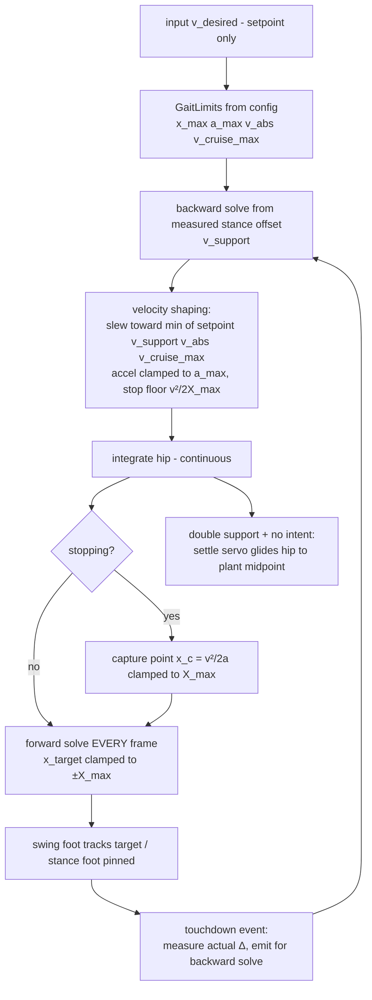

# Raibert Lower-Body Redesign: Closed-Loop Forward/Backward Solver

## Problem Statement

The current kinematic sandbox in [`resolver.rs`](../examples/game_lib/src/lower_body/resolver.rs) is **open-loop**: the hip integrates a scripted velocity profile and feet are placed from predictions frozen at lift-off. This produces three symptom classes:

1. **Both feet stranded ahead of the hip on sudden stop** — the in-flight foot's target was computed for cruise speed; the hip decelerates faster than predicted and stops short. The gait then freezes (`v_desired == 0` gate) with no corrective step.
2. **Foot floating in mid-air at high speed** — `compute_v_max` was derived *before* the `v·T_swing` flight-prediction term was added to the forward planner, so the clamp permits plant offsets of `X_max + v·T_swing`, always out of leg reach; IK clamps the foot along the hip→target ray, lifting it off the floor.
3. **Huge first step on startup** — `v_desired` snaps 0→target instantly; the `kv(v − v_d)` term spikes negative, planting the first foot behind the hip while the accelerating hip runs away from it.

## Design Principles (agreed in discussion)

- **Forward solve** (hip → foot): `x_target = v·(Ts/2 + T_swing) + kv·(v − v_d)`, re-planned **every frame** during swing, clamped to `±X_max`.
- **Backward solve** (foot → hip): generalize `compute_v_max` into `v_support = (Δ + kv·v_d)/(Ts/2 + kv)` where `Δ` is the *measured* foot offset. `v_max` is this function evaluated at `Δ = X_max`. Composition backward∘forward = identity (deadbeat); foot-placement error `e` is annihilated in one stride.
- **Feasibility envelope is analytic and precomputed** — per frame only cheap comparisons:
  - `X_max = √((L1+L2)² − H²)·margin`
  - `a_max = 2·m_e·X_max / T_swing²` (prediction-error ceiling, `m_e ≈ 0.5`)
  - `v_abs = 2·X_max·√m_e / T_swing` (absolute speed ceiling: above this the character cannot stop within its own legs)
  - `v_cruise_max = (X_max + kv·v_d)/(Ts/2 + kv + T_swing)` (corrected denominator)
  - Stop feasibility: decelerate at `max(a_cmd, v²/(2·X_max))` so the capture point is always reachable.
- **Capture-point stop** (Pratt): when `v_d = 0`, aim the foot at `x_c = v²/(2a)` ahead of the hip (clamped to `X_max`), so the hip ends its braking arc *on* the foot.
- **Continuous hip velocity by construction**: `v_desired` is a setpoint; the hip slews toward `min(v_desired, v_support, v_abs, v_cruise_max)` at accel clamped to `a_max`, with the stop-floor on deceleration.
- **XPBD readiness**: the backward loop's input switches from `plant_pos` to measured physics particles later; a damping factor `β ∈ (0,1]` blends `v_support` into the commanded velocity to absorb solver lag. In the kinematic sandbox `β = 1` (deadbeat).

## Architecture



## Implementation Steps

### Step 1 — `GaitLimits` struct (pure math, new)

Add to [`resolver.rs`](../examples/game_lib/src/lower_body/resolver.rs):

```rust
pub struct GaitLimits {
    pub x_max: f32,        // √((L1+L2)² − H²)·margin
    pub a_max: f32,        // 2·m_e·x_max / T_swing²
    pub v_abs: f32,        // 2·x_max·√m_e / T_swing
    pub v_cruise_max: f32, // (x_max + kv·|v_d|)/(Ts/2 + kv + T_swing)
}
impl GaitLimits {
    pub fn from_config(cfg: &LowerBodyConfig, v_desired_mag: f32) -> Self;
}
```

New config field: `prediction_margin: f32` (the `m_e`, default `0.5`, exposed in the egui tuning window).

Tests: hand-computed values with default config (`x_max ≈ 56.4`, `a_max ≈ 1165`, `v_abs ≈ 362`); degenerate cases (H ≥ L1+L2 ⇒ all zeros; T_swing → 0 guarded).

### Step 2 — Generalize the backward solve

Replace [`compute_v_max()`](../examples/game_lib/src/lower_body/resolver.rs:247) with:

```rust
pub fn compute_support_velocity(delta_x: f32, kv: f32, stance_ts: f32, v_desired: f32) -> f32
// v_support = (delta_x + kv·v_desired) / (Ts/2 + kv)
```

`v_max` becomes `compute_support_velocity(x_max, …)` with the **corrected denominator including `T_swing`** (via `GaitLimits::v_cruise_max`). Keep a thin `compute_v_max` wrapper if external callers exist ([`lib.rs`](../examples/game_lib/src/lib.rs:48) re-export).

Tests: identity property `backward(forward(v)) == v`; error-injection property (plant error `e` ⇒ velocity correction `e/(Ts/2+kv)`); update [`test_compute_v_max_formula`](../examples/game_lib/src/lower_body/resolver.rs:532).

### Step 3 — Per-frame re-planning of the swing target

In [`step_leg()`](../examples/game_lib/src/lower_body/resolver.rs:335) Swing branch: recompute `swing_to.x` every frame from current `(v, v_d, hip_x, remaining flight time)`:

```rust
let t_remain = leg.phase_timer;
let x_target = compute_forward_target(v, v_desired, kv, ts) + v * t_remain; // or capture point if stopping
leg.swing_to.x = (hip_x + x_target).clamp(hip_x - x_max, hip_x + x_max);
```

The parabolic lift and `swing_from` stay as-is; only the x-target tracks. This kills the entire stale-prediction bug class (stop, startup, direction flip).

Tests: step-change `v_desired` mid-swing ⇒ `swing_to.x` updates within one frame; target never exceeds `±X_max` from the hip over a full-speed run.

### Step 4 — Capture-point stop

In [`step_lower_body()`](../examples/game_lib/src/lower_body/resolver.rs:401) velocity shaping (step 4 of the pipeline):

- When `v_desired == 0` and `|v| > ε`: required decel `a_stop = v²/(2·x_max)`; effective decel `a = max(accel, a_stop)`; capture point `x_c = v²/(2a)` (guaranteed `≤ x_max`).
- Pass a `stopping: bool` + capture offset into `step_leg` so the swing target aims at `hip_x + sign(v)·x_c` instead of the cruise formula.

Tests: full-speed stop ⇒ hip comes to rest within 2 px of the final plant; capture point ≤ `x_max` for all `v ≤ v_abs`; at `v > v_abs` the speed is clamped so stopping stays feasible.

### Step 5 — Velocity shaping / feasibility clamps

Rewrite pipeline step 4 in `step_lower_body`:

```rust
let limits = GaitLimits::from_config(config, v_desired_scalar.abs());
let v_cmd = min-magnitude-of(v_desired_scalar, v_support, ±limits.v_abs, ±limits.v_cruise_max);
let a = config.accel.min(limits.a_max);          // accel ceiling
let v = approach(state.hip_vel.x, v_cmd, a*dt);  // continuous by construction
```

`v_support` comes from the measured stance-foot offset (backward solve) — in kinematic mode this equals the planned offset, so it acts as a consistency guard; under XPBD it becomes the real feedback. Add config field `beta: f32` (default 1.0) damping the `v_support` blend for future physics.

Tests: `|v| ≤ v_abs` and `|v| ≤ v_cruise_max` at all times during a max-throttle run; velocity is frame-to-frame continuous (`|Δv| ≤ a_max·dt`).

### Step 6 — Touchdown event + settle servo cleanup

- `step_leg` returns `Option<Touchdown { delta_x }>` on Swing→Stance; `step_lower_body` feeds it to the backward solve (this is the hook XPBD will reuse).
- Keep the existing stop-settle servo (double support + no intent ⇒ glide hip to plant midpoint) as final trim; it now only corrects small residuals.
- Keep the intent gate (`v_desired` not `v`) for swing triggers so the settle motion never chains into phantom steps.

Tests: existing [`test_sudden_stop_hip_settles_between_feet`](../examples/game_lib/src/lower_body/resolver.rs) and [`test_no_phantom_steps_after_stop`](../examples/game_lib/src/lower_body/resolver.rs) must pass; add "perturbed plant converges within one stride" (simulate a 10 px landing error, assert next plant error < 1 px).

### Step 7 — Regression suite + sandbox wiring

- All existing tests green: bone-length invariants, hip-straddles-feet at cruise, stance pinning, phase alternation.
- New end-to-end scenario tests: startup ramp (no step exceeds `2·X_max`), cruise, sudden stop, direction reversal, crouch mid-run (H changes ⇒ limits recompute).
- [`raibert_sandbox.rs`](../examples/collision_detection/src/raibert_sandbox.rs) tuning UI: add sliders for `prediction_margin` and `beta`; telemetry rows for `a_max`, `v_abs`, `v_support`, capture point.
- Update [`plans/Raibert.md`](Raibert.md) with the corrected `v_max` denominator, the generalized backward solve, and the feasibility envelope derivations.

## Verification

```
cargo test -p game_lib lower_body     # all pure-math tests
cargo run -p collision_detection --bin raibert_sandbox_main  # visual: startup, cruise, stop, reverse, crouch
```

## Out of Scope (future)

- XPBD coupling: stance-foot pin constraint as real hip feedback (`beta < 1` tuning).
- Non-flat ground (line-trace plant y).
- 2D lateral gait (currently x-only).
