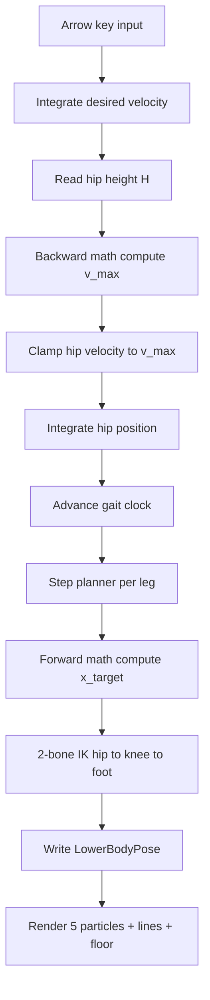

# Raibert Lower-Body Pose Resolver — Kinematic Sandbox Plan

## Goal

Implement the forward/backward Raibert step math from [`plans/Raibert.md`](plans/Raibert.md:1)
as a **pure kinematic** standalone sandbox (no XPBD physics). Five particles
(1 hip + 2 knees + 2 feet) are simulated and rendered as plain `VelloScene`
circles driven directly by a reusable `LowerBodyPoseResolver` component each
frame. Leg lengths default from the v10 blueprint but are fully editable via an
egui tuning window.

## Scope decisions

- **Standalone kinematic sandbox** — no XPBD, no character integration this round.
- **Alternating bipedal gait** — per-leg stance/swing state machine with a 0.5
  phase offset; hip velocity integrates from arrow-key input and is clamped by the
  backward `v_max`; each foot plants via the forward `x_target` to a flat floor.
- **Reusable component** — the resolver lives in `game_lib` (pure, unit-tested),
  rendering + UI live in the `collision_detection` example.

## Architecture



The forward and backward loops share the exact same `kv` and `Ts` constants, so
they cannot fight each other (per [`plans/Raibert.md`](plans/Raibert.md:48)).

## Module layout

All code is in Bevy world coordinates (x-right, **y-up**); the flat floor is a
horizontal line at `floor_y`. The resolver and IK are coordinate-agnostic 2D.

### 1. `examples/game_lib/src/lower_body/mod.rs` (new)
Re-export surface + config + state + pose types.

### 2. `examples/game_lib/src/lower_body/resolver.rs` (new, pure + tested)
- `LowerBodyConfig` — UI-editable knobs (see defaults below).
- `GaitPhase` (`Stance` / `Swing`) and per-leg `LegState { phase, foot_pos }`.
- `ResolverState { hip_pos, hip_vel, gait_clock, left, right }`.
- `LowerBodyPose { hip, left_knee, left_foot, right_knee, right_foot }`.
- `DebugInfo { x_max, v_max, v_desired, foot_target_l, foot_target_r, phase_l, phase_r }`.
- `step_lower_body(input_dir, &config, &mut state, dt) -> (LowerBodyPose, DebugInfo)`.
- `solve_leg_ik(hip, foot_target, thigh_len, calf_len, bend_sign) -> knee` — law-of-cosines,
  mirroring the existing [`solve_reach_ik`](examples/game_lib/src/character/ik.rs:25).
- Unit tests (mirror the [`ik.rs`](examples/game_lib/src/character/ik.rs:269) test style):
  backward `v_max` formula, forward neutral point `v·Ts/2`, `X_max` Pythagorean,
  gait phase alternation, stance foot-hold invariant, IK length preservation.

### 3. `examples/game_lib/src/lower_body/systems.rs` (new)
- Bevy system that reads input, calls `step_lower_body`, and writes the result to a
  `LowerBodyPose` + `DebugInfo` component on the sandbox entity.

### 4. `examples/game_lib/src/lower_body/plugin.rs` (new)
- `LowerBodySandboxPlugin` registering the system.

### 5. `examples/game_lib/src/lib.rs` (edit)
- Add `mod lower_body;` and re-export the new public types.

### 6. `examples/collision_detection/src/raibert_sandbox.rs` (new module)
- Spawn the sandbox entity with `LowerBodyPoseResolver` component + 5 circle scene
  entities (hip/kneeL/kneeR/footL/footR) + a rebuilt-each-frame line/floor scene.
- egui tuning window exposing every `LowerBodyConfig` field.
- Spawn a flat floor visual.

### 7. `examples/collision_detection/src/raibert_sandbox_main.rs` (new bin)
- Thin `main()` mirroring [`character_tuning_main.rs`](examples/collision_detection/src/character_tuning_main.rs:158)
  but stripped to only the sandbox (no character/physics chain).

### 8. `examples/collision_detection/Cargo.toml` (edit)
- Add the `[[bin]] raibert_sandbox` entry.

## Raibert math (implementation reference)

Forward (swing phase), step target relative to hip:

```
x_target = (v * Ts) / 2 + kv * (v - v_desired)
```

Backward (velocity clamp), with dynamic leg reach:

```
X_max = sqrt((L1 + L2)^2 - H^2) * safety_margin
v_max = (X_max + kv * v_desired_sign) / (Ts/2 + kv)
```

Per-frame pipeline (1D along x in the sandbox):

1. Read `target_hip_height` (normal vs crouch).
2. `X_max` from `H`.
3. Backward math → `v_max`.
4. Clamp `hip_vel.x` to `[-v_max, v_max]`.
5. Forward math → `x_target` for each leg in swing.
6. Snap the foot to `(hip.x + x_target, floor_y)` on plant; parabolic lift during swing.
7. 2-bone IK for each leg → knee/foot world positions.

## UI seed defaults (v10-derived, editable)

| Field | Default | Notes |
|---|---|---|
| `thigh_len` | 55.0 | ≈ 111 blueprint × 0.5 world scale |
| `calf_len` | 55.0 | ≈ 111 blueprint × 0.5 world scale |
| `hip_height` | 90.0 | < thigh+calf to keep knees bent |
| `stance_duration_ts` | 0.28 s | `Ts` |
| `kv` | 0.12 s | velocity gain |
| `target_speed` | 120 px/s | `v_desired` magnitude |
| `accel` | 800 px/s² | velocity smoothing |
| `safety_margin` | 0.85 | 0..1 |
| `step_height` | 28 px | swing apex |
| `floor_y` | 0.0 | flat floor line |
| `crouch_height` | 55.0 | crouched `H` |
| `bend_sign` | +1 | knee bends forward |

## Definition of done

- `cargo run -p collision_detection --bin raibert_sandbox --release` boots a window
  showing 5 circles + floor + connecting lines.
- Arrow keys drive the hip; the two legs alternate stance/swing; velocity clamps
  on crouch; feet plant on the flat floor.
- All `LowerBodyConfig` fields editable live via egui.
- Pure resolver has passing unit tests (`cargo test -p game_lib`).