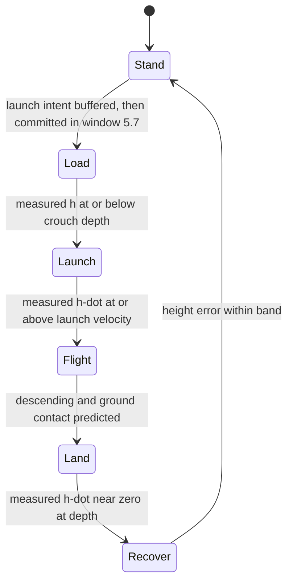
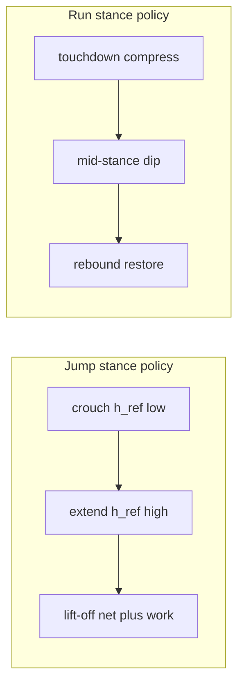
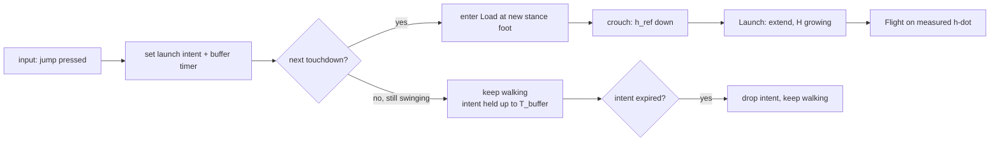
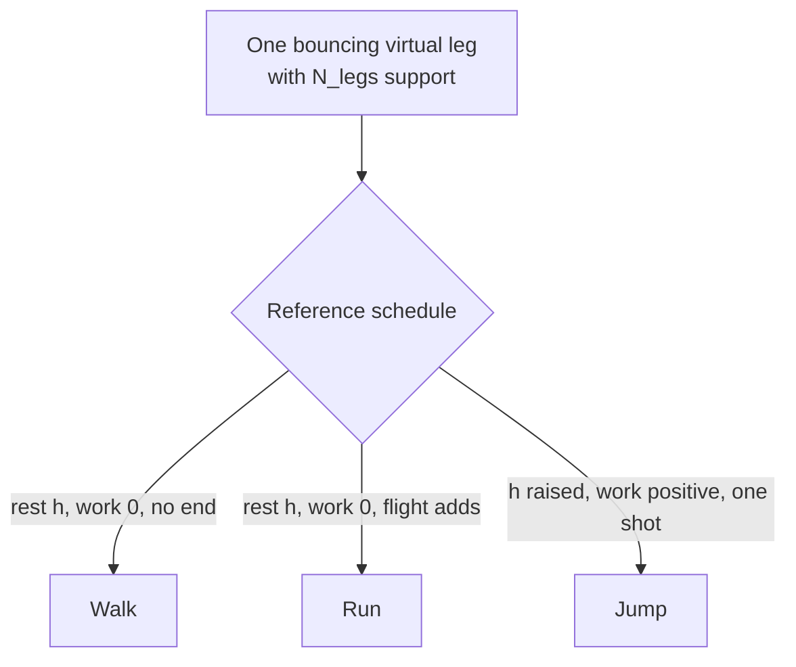
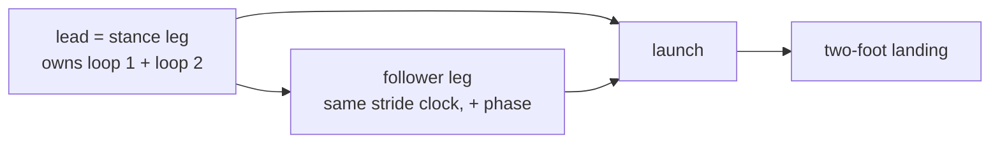
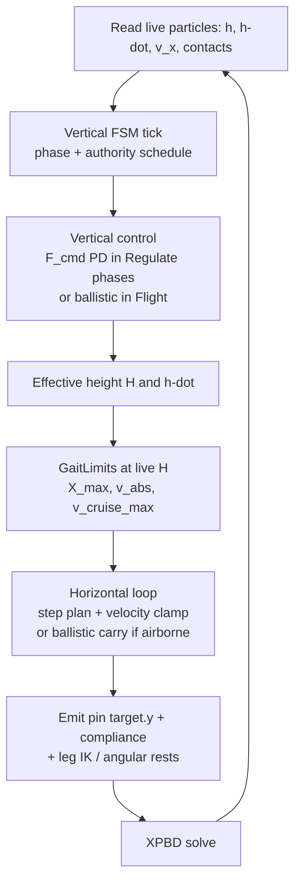

# Raibert Vertical Loop — Math & Integration (Discussion Draft)

> Status: **DISCUSSION DRAFT** — math first, for review. No implementation yet.
>
> Companion to [`Raibert.md`](Raibert.md) (horizontal placement + velocity clamp),
> [`raibert_redesign.md`](raibert_redesign.md) (closed-loop refactor), and
> [`gravity_four_layer.md`](../../plans/gravity_four_layer.md) (gravity + pin ordering).
>
> Scope: **the vertical half of the algorithm** — the height loop (Raibert loop 1),
> its math, and how it welds onto the horizontal loop we already built in
> [`resolver.rs`](../../bevy_vello/examples/game_lib/src/lower_body/resolver.rs).
> Jumping and running are the same vertical loop at different cadences; this doc
> derives the vertical loop itself and treats jump as the canonical instance.

---

## 0. The one-paragraph version

We already have the horizontal half: place the foot, clamp the hip so it never
outruns its feet, drive forward. That loop is a **feasibility clamp on a
continuously observable state** (`v_hip`, foot reach), which is why it runs every
tick. The vertical half is the same physics in the other axis, but its *outcome*
(apex height) is **not observable until the apex occurs**. So the vertical loop is
deliberately **two-timescale**: a fast per-tick regulation while a foot is on the
ground, and a slow per-hop correction of the launch velocity, with the loop
switched **off** during flight because there is nothing to regulate against and
acting there deletes gravity instead of correcting it.

---

## 1. The governing principle: observability cadence

Do not split the algorithm by "walking vs. jumping." That split is misleading —
both are cyclic, and a jump is just a cycle that terminates. Split it by **what is
observable, at what rate**:

| Axis | Observable state | Loop rate | Our actuator |
|---|---|---|---|
| Horizontal | `v_hip`, foot↔hip offset | every tick | hip velocity clamp + step planner |
| Vertical (stance/launch/land) | `h`, `ḣ` | every tick | pin authority: `target.y` + `compliance` |
| Vertical (flight) | *nothing actionable* | — | **none — assist disabled** |
| Vertical (apex outcome) | achieved apex | per hop | corrected launch velocity next hop |

Two consequences fall out immediately:

1. **The fast loop is where physics lag is absorbed.** If the soft leg is slow to
   compress or extend, the per-tick regulation simply keeps applying the correct
   force until the measured state condition is met. Durations stretch; force stays
   sane. This is the exact pattern already trusted at the anti-phase gate
   ([`resolver.rs:538`](../../bevy_vello/examples/game_lib/src/lower_body/resolver.rs:538)) —
   trigger on **measured state**, never on elapsed time.
2. **The loop must go quiet in flight.** Re-commanding height mid-air makes the
   external position constraint cancel gravity, which is the *hover artifact*.
   Flight is unactuated by physics; pretending otherwise is the bug.

---

## 2. The vertical model: one virtual leg

Raibert's original is a **SLIP** model — *spring-loaded inverted pendulum*. The
whole biped is reduced to a single telescoping leg under the center of mass. For a
symmetric biped jump this is not an approximation we tolerate, it is *correct*:
both legs act in parallel through the same CoM, so they collapse to one virtual
leg with:

```
L      = leg length (hip → foot contact point)
F_leg  = total virtual leg force (sum of both legs' axial forces)
m      = mass of the driven body (P1..P3 chain)
g̃      = effective gravity in solver units  (see §7 caveat)
h      = CoM height above the ground reference
```

The CoM vertical dynamics, up-positive:

```
m · ḧ = F_leg − m · g̃
```

Everything below is bookkeeping on this one equation. **Loop 1 is "choose
`F_leg`."** Our implementation of "choose `F_leg`" is the external position
constraint on P1/P2/P3 whose `target.y` and `compliance` set the hip's commanded
height and stiffness — the same pair we already queue at
[`systems.rs:148`](../../bevy_vello/examples/game_lib/src/character/systems.rs:148).

### 2.1 Support aggregation: the controller sees a virtual leg, not feet

Raibert's controller was built for a **single-leg hopper**, which is exactly why it
should *not* distinguish one foot from two. It never names "left" or "right" — it names
`L`, `v`, `F_leg`, and sees only what the *support* presents. The biped therefore
interfaces to it through a **support count** `N_legs ∈ {0, 1, 2}`:

```
F_leg(t)  = Σ_i  k_i · (L0_i − L_i)              over legs currently in contact
L(t)      = vertical extent of the support  =  h / cos(θ_support)
k_eff     = Σ_i k_i                              parallel springs; two legs = 2× stiffness
N_legs    = number of feet in contact            (0 ⇒ Flight, no actuator)
```

Substituted into `m·ḧ = F_leg − m·g̃`, this is all the single-leg controller needs. The
two derived quantities behave very differently with respect to `N_legs`:

```
ḣ₀*  = sqrt( 2·g̃·Δh* )        ← set by desired apex alone; NO dependence on legs or mass
d*   = ḣ₀* · sqrt( m / k_eff )  ← depends on k_eff, so two legs halve the stroke
```

**So one leg vs. two legs is a parameter change, not a mode.** The launch-velocity
target is identical; only the required stroke and the force authority change. And
because a biped has roughly `2×` the mass *and* `2×` the stiffness of one leg, the two
effects cancel in `d*` — the stroke is what matters, not the foot count.

**Design rule:** `N_legs` is **read from contact state, never commanded.** The
controller aggregates whatever support exists that tick. There is no "two-foot jump"
code path and no "one-foot jump" code path — there is one loop with a support term
`Σ k_i`, and the count is an input.

### 2.2 The loop is dynamic, not kinematic: displacement is the currency

**Raibert's original is a dynamic controller.** Loop 1 does not set a height; it
chooses the **thrust force** of a real spring leg. The leg compresses (`F_leg` up),
the body accelerates, and **contact is lost when the spring can no longer hold
against gravity**. The resulting speed `ḣ₀` *is* the jump. Height appears only as a
*consequence* of integrating `m·ḧ = F_leg − m·g̃`. There is no pose to pin anywhere in
the original loop.

The kinematic sandbox we run today is not that. Its vertical channel is a **stub** —
[`resolver.rs:668`](../../bevy_vello/examples/game_lib/src/lower_body/resolver.rs:668)
writes `hip_vel.y = 0.0` and
[`resolver.rs:672`](../../bevy_vello/examples/game_lib/src/lower_body/resolver.rs:672)
pins `hip_pos.y = floor_y + h`. That is *pure kinematics*: height is a commanded
number, gravity is never integrated, and no thrust is ever chosen. **That stub is
exactly what §6.4 removes.** Once it is gone the sandbox runs the same dynamic loop as
the robot, and "is it kinematic?" stops having two answers.

#### Displacement is the currency, not force

Raibert's loop 1 does **not** care *how* the vertical displacement is produced. It only
asks **how far down you go**:

```
bank:   crunch the hip down by d*           (pure vertical displacement)
spend:  push until measured ḣ reaches ḣ₀*   (pure vertical velocity)
```

`k` — bone stretch, knee angle, motor torque, whatever — is **invisible to the
interface**. It decides *how much force* realizes the displacement (`F = k·d*`), not
the displacement itself. And because §4 closes on **measured `ḣ`**, even that force
question disappears: we push until the body is *actually* moving at `ḣ₀*`, however
efficiently the crunch converted into motion.

So there are two budgets, and **only the first is the algorithm's**:

| budget | currency | universal? | the controller's business? |
|---|---|---|---|
| **displacement** | `d*` = how far the hip drops | yes — geometry / pose | **yes — this is the whole input** |
| **force** | `F = k·d*` = can the actuator push it | no — bone / joint-spring / motor | **no — measured ḣ absorbs it** |

#### How much to crunch: displacement, calibrated not derived

The algorithm's input is exactly one number — **how far down the hip goes, `d`** — and
it does not care what produces it: a telescoping bone, a bending knee, a motor angle.
Stiffness only sets the *force* `F = k·d` that realizes `d`; it never enters the
interface.

There is one subtlety to be honest about: the mapping from a target apex to a required
`d` *does* contain `k`, because the stored energy is the **spring's** `½·k·d²`, not the
body's `m·g·d`:

```
ḣ₀ = d·√(k/m)            (from  ½·m·ḣ₀² = ½·k·d²)
Δh = ḣ₀²/(2·g̃)  ∝  d²     (apex grows as the square of the crouch)
```

so a naive inversion `d* = ḣ₀*·√(m/k)` is stiffness-loaded — **we never evaluate it.**
Instead: because `ḣ₀` is **linear in `d`**, the stiffness cancels from any *ratio* of two
hops, so the required displacement is **calibrated by one probe hop and then scaled**:

```
probe hop      measure ( d_0 , ḣ₀_0 )      how far we crunched, how fast we left
speed-space    d* = d_0 · ( ḣ₀* / ḣ₀_0 )    linear in d
apex-space     d* = d_0 · √( Δh* / Δh_0 )   since Δh ∝ d²
```

That is the exact sense in which **the algorithm is about displacement**: the command is
a distance, the correction is a *ratio* of distances, and the plant's stiffness is
**baked out by measurement rather than modelled**. "How much you crunch down" is a
measured, scaled quantity — not a formula in `k`.

> **Rule of thumb:** roughly, halving the crouch quarters the apex (`Δh ∝ d²`), so a
> small depth change buys a large height change. The exact factor is whatever the probe
> hop measured.

#### The implementation reads displacement and velocity, never stiffness

The knobs in this framing:

```
commanded crouch  d*  = calibrated displacement (see above)         PRIMARY input
required speed    ḣ₀* = sqrt(2·g̃·jump_apex)                          apex
conversion        F   = k_eff · d*                                  emergent — ABSORBED, not read
```

`k_eff` is the one term that is not a displacement, and it is deliberately **kept out
of the hot path**. It survives only as an **optional diagnostic**: if the measured apex
under-shoots its target by more than the probe-hop scaling predicts, that is the signal
"the leg ran out of force at this stroke" — a tuning alert, not a control decision.

> **The loop reads displacement and velocity. It never reads stiffness.** Stiffness is
> the plant's private business, and the measured-`ḣ` cutoff (§4) is what makes it so.

So the tick is: (a) run **Load down to the commanded crouch depth `d*`** (bank the
displacement), (b) run **Launch until measured `ḣ ≥ ḣ₀*`, or the hip reaches full
extension with `ḣ` still short** (spend it, and accept a lower hop if the bank was too
small), and (c) **never command height as if it were free**. That is the difference
between the dynamic plan and the kinematic stub: the stub *is* (c); the plan is (a)+(b).
The depth `d*` itself comes from the calibration above, not from `k`.

---

## 3. The three vertical regimes, and their math

### 3.1 Flight — ballistic (unactuated)

Kinematics only. With `ḣ₀` the vertical velocity at lift-off and `h_td` the height
at that instant:

```
ḣ(t) = ḣ₀ − g̃·t
h(t) = h_td + ḣ₀·t − ½·g̃·t²
```

Derived quantities the loop needs:

```
apex height      Δh_apex = ḣ₀² / (2·g̃)          (above lift-off height)
time to apex     t_apex  = ḣ₀ / g̃
flight time      T_fl      = 2·ḣ₀ / g̃            (return to same height)
landing speed    ḣ_land  = −ḣ₀                  (energy-conserving, symmetric)
```

**Read this as the control target.** To reach a desired apex rise `Δh*`:

```
ḣ₀* = sqrt( 2 · g̃ · Δh* )
```

That single line is the whole objective of loop 1. Note it contains **no mass and
no stiffness** — the required *lift-off velocity* is fixed by geometry and `g̃`
alone. Mass and stiffness only determine *how hard* the leg must push to get there,
not *how fast* it must be moving when it leaves. This is why loop 1 can be robust on
a soft body: it closes on a **measured** kinematic quantity (`ḣ`), and the
force/stiffness only decides whether the *stroke within which that velocity is bought*
is available (§2.2, §4A).

### 3.2 Stance — the spring (actuated), and where the stiffness really lives

While a foot is grounded, the virtual leg behaves as a spring-damper with rest
length `L₀`:

```
F_leg = k·(L₀ − L) + c·(−L̇)          (compression positive inward)
```

Substituting `h ≈ L·cos(θ_leg)` and noting the horizontal loop keeps the leg
near-vertical during a jump (`θ_leg ≈ 0`), we can treat `h ≈ L`:

```
m·ḧ = k·(L₀ − h) − c·ḣ − m·g̃
```

Static balance (hold a height): `k·(L₀ − h) = m·g̃` ⇒ the equilibrium height and the
leg force are two views of the same `L₀` command. So **"command a height" and
"command a leg force" are interchangeable**, which is exactly why the height loop
can be implemented as a position constraint with a stiffness.

**But be precise about whose stiffness `k` is.** The thigh and calf are
**fixed-length links** — [`solve_leg_ik()`](../../bevy_vello/examples/game_lib/src/lower_body/resolver.rs:406)
clamps reach into `[|L1−L2|, L1+L2]` and never scales a bone. The leg cannot telescope
by stretching a rod. What "soft" vs. "stiff" describes is the **angular stiffness that
resists the knee bending** under load — see the `Angular/P1_P2_P3` joint
(`compliance = 1e-7`) and the ankle joints (`compliance = 5e-7`) in
[`v10.character.json`](../../bevy_vello/examples/collision_detection/assets/character/v10.character.json:566).
A *bending* knee shortens the hip height; a *stiff* knee keeps the leg extended. So:

```
k  ≡  effective vertical stiffness of the knee/foot angular chain
      =  d(vertical foot force) / d(hip height)        (derived, not a rod constant)
```

It is emergent, with two independent sources, and conflating them is the first
design trap:

| source | what it is | who owns it |
|---|---|---|
| **link kinematics** | the geometric constraint `L ≤ L1+L2` | the IK / rigid links (hard) |
| **joint stiffness** | the angular spring holding the knee open | the XPBD joint `compliance` (soft) |
| **body pin** | the external position constraint moving the hip | the controller — this is the *thrust* |

#### Force authority: who actually commits the force?

The controller does **not** directly integrate a leg force. It sets the *desired* hip
pose, and the XPBD joint springs **realize** it against the real body. That is the
mechanism, and it has a hard consequence:

> **The kinematic pose is a request, not the truth. The loop must close on the
> *measured* hip state (position and `ḣ`), never on the pose it asked for.**

Concretely, `Δtarget` is a stiffness-normalized request:

```
requested hip displacement   Δtarget = F_cmd / k_eff        (dial the pin)
realized by                  XPBD joint springs, stiffness K = 1/compliance
```

`k_eff` in the force loop and `K = 1/compliance` in the solver are the *same dial seen
from two sides*: you command a `target.y` offset and the joint springs deliver whatever
force they can toward it. The delivered force is `K·(error)`, which is exactly why the
launch cutoff in §4 watches **measured `ḣ`**, not the pin's error term.

Two named sub-behaviors in stance:

**Regulate (Stand / Recover).** PD toward a held reference `h_ref`:

```
F_cmd = m·( g̃ + k_p·(h_ref − h) + k_d·(ḣ_ref − ḣ) )
```

with `ḣ_ref = 0`. Convert `F_cmd` to a commanded height offset for the position
constraint: `Δtarget = F_cmd / k_eff`, or equivalently lower/raise `target.y` and let
`compliance` supply `k_eff`. Gains are expressed **per fixed tick**, not per second
(§6.3).

**Launch (Load → Launch).** Inject energy so that lift-off happens at `ḣ₀*`. The
spring stores, then releases, the kinetic energy `E* = ½·m·ḣ₀*²`. A compression
stroke `s` stores `½·k·s²`, so:

```
required stroke   s* = ḣ₀* · sqrt(m / k)
```

Larger `k` ⇒ shorter stroke for the same apex. This is the real "crouch depth ↔ jump
height" tradeoff, derived rather than tuned. Peak leg force during launch is
`F_peak = k·s* + m·g̃`. The pair `(s*, F_peak)` is the **stroke budget** of §2.2, and
§4A shows how to *invert* it: given a measured apex error, recover the stroke/force to
change on the next hop.

### 3.3 Landing — absorb (Land → Recover)

Incoming energy `E_land = ½·m·ḣ_land² = m·g̃·Δh_apex` must be absorbed by a
compression stroke `d`:

```
required absorb stroke   d* = ḣ_land · sqrt(m / k)
peak impact force        F_peak ≈ k·d* + m·g̃
```

Then settle: relax `L₀` back toward the standing equilibrium over a few ticks and
join `Stand`. Softness here is a *feature* — the compliant landing is exactly the
physics we want to keep, and the loop just has to not fight it.

### 3.4 Support modes and the lift-off condition

The virtual leg telescopes between two geometric limits, and which modes are even
*available* is decided by a single inequality. With leg length `L`, standing reach
`L₀`, hip height `h`, and leg lean `θ_leg` from vertical:

```
L(h)           = h / cos(θ_leg)
can push off?  L(h) < L₀      → the pin can extend the leg against the ground
can absorb?    L(h) > L_min   → the pin can pull the body toward crouch
```

The geometric link limit is `L₀ = L1 + L2 = 110 px`. The usable launch stroke is the
*extension distance* the hip can travel while the knee stays bent enough to push:

```
d*  =  L₀ − h      (measured at the loaded pose, not the stiff-link ceiling)
```

There is a documentation drift worth resolving here: the resolver config sets
`hip_height = 90` ([`resolver.rs:76`](../../bevy_vello/examples/game_lib/src/lower_body/resolver.rs:76)),
while a rigid `L₁+L₂ = 110 px` leg reaches `H_stand ≈ 106 px`. The `90` is the *soft*
standing equilibrium (knee already bent), not the geometric maximum. Both matter:

| stance | hip height `h` | banked stroke `d* = L₀ − h` |
|---|---|---|
| soft standing (`hip_height = 90`) | 90 px | ~20 px |
| deep crouch (`crouch_height = 55`) | 55 px | ~55 px |
| stiff-link ceiling (`H_stand = 106`) | 106 px | ~4 px |

So the stroke is **not** stuck at 4 px. The character already crouches to `55 px`,
which banks `~55 px`; and because `s* = ḣ₀*·sqrt(m/k_eff)` (§3.2), the same apex can be
bought either with a deeper stroke **or** a softer `k_eff`. `crouch_depth` is
therefore the *primary* budget lever — **Load deeper to pop higher**, with
`crouch_height` as the mechanical stop. That is precisely why `Load` exists (§2.2):
it is not a controller trick, it is how the stroke is banked.

**Lift-off is the moment the support fails.** While the pin can hold the body against
gravity (`F_leg ≥ m·g̃`), the leg stays extended and support is active. When it cannot
(`k·d* < m·g̃` at full extension), gravity wins, `h` starts to fall, and the loop
releases. In our actuator this is the *held vs. released* pin semantics in
[`gravity_four_layer.md`](../../plans/gravity_four_layer.md:33) — loop 1 does not
detect lift-off, it simply stops being able to cancel gravity.

---

## 4. Loop 1 proper: the per-hop integrator (the whole algorithm)

Loop 1 is a **per-hop height error fed into a thrust selector** — and written out, it is
one line. Let `Δl` be the **extra stroke** (commanded leg compression on top of the
passive baseline) applied during a stance:

```
Δl = Δl_prev + k_p · ( h_desired − h_apex )
```

| term | meaning |
|---|---|
| `Δl` | extra stroke / thrust to apply this stance (the output) |
| `Δl_prev` | thrust applied last hop — **integrator term**, memorizing the baseline energy needed to fight gravity |
| `h_desired` | target apex height (the intent) |
| `h_apex` | **measured** peak height of the last hop |
| `k_p` | proportional gain |

The shape is the point: **a proportional error term added to an integrator that
remembers the baseline.** That is a PI controller *in the stroke variable*, and the
integral term is what makes it survive a body whose mass and stiffness we cannot read —
the baseline energy is **learned hop over hop, never derived.** And `Δl` is a
**displacement**, so §2.2 holds: the algorithm speaks distance, and stiffness never
appears.

In our stack the loop reads and writes:

```
h_apex    = running max of measured hip_pos.y across the hop    (per-hop boundary)
h_desired = from the jump intent + schedule                      (§5, §5A)
Δl        -> commanded extra crouch depth this stance            (the actuator input)
```

`h_apex` does not exist until the apex happens — that is the **observability boundary**
of §1, made concrete, and it is *why* loop 1 is per-hop rather than per-tick.

**This is the algorithm.** Everything else in this document is one of three layers
*around* it:

| layer | job | cadence |
|---|---|---|
| inner execution (§4.1) | turn `Δl` into real thrust, and pick the tick to release | per tick |
| measure (§4.0) | detect the apex; sample `h_apex` | per hop |
| outer schedule (§5, §5A) | choose `h_desired` and when to launch | per hop / stance |

### 4.0 Measuring the apex

`h_apex` is the hop's true peak, so it is only known *after the fact*. Sample it as the
running maximum of the measured hip height, and latch it at the sign change of vertical
velocity:

```
if measured ḣ crosses positive -> negative (top of the arc):
    h_apex_measured = running_max(hip_y)
    Δl      = Δl_prev + k_p · (h_desired − h_apex_measured)     # applied next stance
    Δl_prev = Δl
```

A running max means a noisy single sample cannot corrupt the measurement, and a landing
that overshoots still reports the true peak. This is the whole per-hop loop.

### 4.1 How `Δl` becomes thrust — the measured-`ḣ` inner loop

`Δl` is a displacement request. To realize it, command the extra crouch and push, and
**stop the push on measured velocity, not on the requested pose.** In speed space that
exit point is:

```
target launch speed   ḣ₀* = sqrt( 2·g̃·h_desired )
during Launch:
    keep extending (raise target.y / reduce compliance)
    each tick: if measured ḣ ≥ ḣ₀* − ε          →  release authority, enter Flight
               if the hip reaches full extension with ḣ still short  →  release anyway
```

Why exit on measured `ḣ` rather than on the pose we asked for:

- The pose is a **request**; the XPBD joint springs deliver whatever force they can
  toward it (§3.2). Exiting on the pose would trust a request the soft body may not have
  honored.
- Measured `ḣ` is **the same variable as `Δl`** up to a scale (from `ḣ₀ = d·√(k/m)`,
  §2.2). So this inner exit is *not a second algorithm* — it is the `Δl` law re-expressed
  at tick resolution, in the units the plant actually reports.
- It needs **no mass and no stiffness**: it never evaluates `√(k/m)`.

The per-hop `Δl` law is the coarse correction; this cutoff is the fine one. They compose:
`Δl` sets *how far to crunch*, the cutoff decides *the exact tick to let go*.

### 4A. The forward and backward halves (why no model fit is needed)

The jump is a predict-and-correct loop exactly like the walk, and the pair splits
cleanly.

**Forward function — predict (pure kinematics, needs only measured state):**

```
h(t)      = h_td + ḣ₀·t − ½·g̃·t²
ḣ(t)      = ḣ₀ − g̃·t
h_apex    = h_td + ḣ₀²/(2·g̃)          t_apex = ḣ₀/g̃
T_flight  = 2·ḣ₀/g̃
```

**Backward function — correct (the `Δl` law of §4, an integrator on measured apex):**

```
Δl = Δl_prev + k_p · ( h_desired − h_apex_measured )
```

That is the entire predict / correct structure — and note what is **absent**: no mass
estimate, no stiffness estimate, no leg model. The walking loop's backward half is
[`compute_support_velocity`](../../bevy_vello/examples/game_lib/src/lower_body/resolver.rs:316),
a closed-form algebraic solve; the jump's backward half is an **integrator on measured
apex**, because the apex is the only boundary-observable quantity. Different math, same
shape: *gain × boundary error*, applied at the boundary.

#### Simplification: keep one law, in height space

An earlier draft carried a *second* correction law in speed space,

```
ḣ₀*_next = √( ḣ₀*² + 2·g̃·(Δh* − Δh_apex_measured) )     <- NOT REQUIRED
```

which is just the `Δl` law expanded through the ballistic relation. Because the `Δl`
integrator already has integral memory (`Δl_prev`) and sits directly in the measured
variable, **we do not need the speed-space form.** One law, in displacement/height
units — the units of the measurement. This removes a whole class of double-correction
and gain-tuning bugs.

#### The per-tick order

```
1. READ MEASURED   h, ḣ, v_x, per-foot contact        (from XPBD)
2. FORWARD         h_apex prediction, next-plant prediction
3. COMPARE         apex error (per hop), plant error (per stance)
4. BACKWARD        vertical   : Δl = Δl_prev + k_p·(h_desired − h_apex)
                   horizontal : v_support = (Δ + kv·v_d)/(Ts/2 + kv)
5. APPLY           set pin target.y (plus extra crouch Δl), plant targets
6. INTEGRATE       XPBD advances the real body        (repeats next tick)
```

#### Does the vertical loop need an *iterative* solver within a tick?

No. The horizontal loop iterates within a tick because the feasible plant position is an
*algebraic* unknown that moves as the hip moves. The vertical loop's unknown is
`h_apex`, which is **not an algebraic fixed point** — it is a per-hop measurement fed to
an integrator. So one forward pass plus the `Δl` update per hop suffices; the
"iteration" lives **across hops**, and the inner loop (§4.1) is only a per-tick
threshold test.

#### Does the vertical loop need an *iterative* solver within a tick?

The original worry — *must the jump be an iterative solver like the walk?* — resolves
here. Within one tick, **no**. The horizontal loop iterates within a tick because the
*plant position is an algebraic unknown*: as the hip moves, the feasible foot target
moves, so `plan -> clamp -> plant` must be re-solved to a fixed point. The vertical
loop's unknown is `ḣ₀`, and `ḣ₀` is a **state variable evolved by the integrator**, not
a per-tick algebraic fixed point — so one forward pass plus one backward clamp per tick
suffices. The "iteration" in the jump lives *across hops* (the per-hop correction
above), which is the boundary loop of §1.

**Summary:** the jump has a forward function (ballistic predict, no model fit) and a
backward function (exact limits + the stroke cap). It is the same predict/correct shape
as the walk; the only difference is *which* state is boundary-observable.

---

## 5. Whole-body phase FSM

The FSM is the *authority schedule*: which phases the vertical pin is on, how stiff,
which reference it tracks, and — critically — **state-based triggers**, never timers.



| Phase | Vertical authority | Reference | Horizontal loop | Trigger to next |
|---|---|---|---|---|
| Stand | on, stiff | `h = hip_height` | normal (step planner) | jump intent, committed in window §5.7 |
| Load | on, soft | `h -> crouch_height` | normal, H shrinking | `h ≤ h_crouch` measured |
| Launch | on, stiff | extend toward full reach | normal, H growing | `ḣ ≥ ḣ₀*` measured |
| Flight | **OFF** | none | ballistic carry (§6.2) | `ḣ < 0` and contact predicted |
| Land | on, soft | `h = h_land` | feet re-plant | `|ḣ| ≈ 0` at depth |
| Recover | on, medium | `h -> hip_height` | normal | `|h − hip_height| < band` |

Two invariants the FSM must enforce, both timing bugs we can *name in advance*:

- **Release before contact does the work.** If the assist is still pushing while the
  floor is already pushing, the two add and you "double-push." The Launch → Flight
  transition on *measured lift-off* (contact loss) is what prevents it.
- **Never regulate in Flight.** Vertical authority goes to zero at the
  Launch → Flight edge and stays zero until Land. This is the anti-hover assertion.

The jump is a **step change of the height reference plus a terminating FSM**. Running
is this same loop with a constant `h_ref`, no termination, and a cyclic horizontal
loop. The vertical machinery is shared; only the reference schedule differs.

### 5.5 Jump as a continuous process: the support-count question

A two-feet-together hop sounds like it forces a stop-and-crouch, which would break
continuity. It does not, because §2.1 already dissolved the question: the controller
consumes a **support count**, not a jump style. Both jumps are the same §5 FSM with a
different `N_legs` at `Load`:

| Situation | `N_legs` at Load | Stroke / authority | When |
|---|---|---|---|
| Standing / stalled | 2 | `k_eff` large ⇒ short stroke, big authority | deliberate stop, big landing absorb |
| Mid-gait, both feet happen down | 2 | as above | the double-support window of a walk |
| Mid-gait, one foot down | 1 | one leg's `k_eff` ⇒ more stroke per unit force | **the default for a moving jump** |
| Airborne | 0 | none — Flight | no actuator; not supported |

**Support both, because it is literally the same loop.** There is no extra machinery
for the two-foot case (§2.1): it is the same `F_leg = Σ k_i` with more terms. Wiring
both is *free*, and it is worth doing because a stopped character that lands and
launches on two feet is far more stable — it cannot topple. The one-foot case is what
makes the moving jump continuous.

**The default is single support, but it is a measurement, not a command.** A running
gait's stance clock already alternates feet, so a jump triggered mid-stride finds
`N_legs` at whatever it currently is. Two rules make it continuous:

- trigger `Load` on the currently-grounded support (state-driven per §1, no gather
  step, no "put the feet together"),
- raise `h_ref` so the support extends the virtual leg (§3.4), releasing into `Flight`
  when measured `ḣ ≥ ḣ₀*` (§4).

The clock keeps running and the other leg keeps swinging: the jump is a *modulation of
the existing cycle*, not a mode switch.

**When `N_legs = 2`, only the stroke changes.** `k_eff = Σ k_i`, so two legs give twice
the stiffness and the same `ḣ₀*` needs half the stroke `d*`. But the standing stroke is
only `L0 − H_stand ≈ 4 px` (§3.4), so two legs cannot produce a big pop from rest
either — the real lever for a stopped jump is a **deeper crouch** (lower `h_ref`),
independent of leg count.

**The rule that keeps it honest:** `N_legs` is read from *measured* contact state,
never from a scripted gather. If both feet are down, the loop uses both; if one is
down, it uses it. Commanding a foot-repositioning motion is the choreography we avoid
by construction.

**Landing** mirrors the same rule: a big jump may land on both feet if the other
arrives in time, but the loop must never *require* it — the planted foot owns the
absorb, so a one-foot landing on a ledge works unchanged.

### 5.6 Single-support jump vs. running

Mechanically these are the *same motion*: one foot on the ground, push, fly, land,
repeat. Raibert's own taxonomy agrees — both are `β < 0.5` bouncing gaits. So the
difference is not in the physics; it is in the **objective**, and therefore in the
**stance policy** and in how *long the FSM refuses to terminate*.

| | Single-support jump | Running |
|---|---|---|
| Objective | maximize **apex height** once | maximize **forward speed** over many strides |
| Sets `ḣ₀*` via | `sqrt(2·g̃·Δh*)`, `Δh*` a held target | just enough rebound to protect `v_x` at touchdown |
| Stance `h_ref` policy | **monotonic extension** (`h` rises) | **compression then rebound** (`h` dips at mid-stance, returns) |
| Net work per stance | strongly **positive** (energy injected) | near **zero** (elastic store-and-return) |
| Flight | happens **once**, then the FSM ends | **every** stance, periodically, forever |
| Horizontal loop role | demoted to a landing **predictor** | **primary** — it owns `v_x` |
| Termination | yes (`Recover → Stand`) | never |
| Stability need | land and settle | single-support is an inverted pendulum; the *next* foot must catch it, every step |

**The deepest difference is the stance policy, i.e. the sign of the work.** A jump's
stance *extends* the leg against the ground to inject energy (`Δh_ref > 0`). A run's
stance *compresses* under the landing and rebounds — net energy roughly conserved, so
the leg gets **shorter at mid-stance** and back. Same loop, opposite `h_ref`
schedule:

```
jump stance:     h_ref  monotonically ↑        (crouch → extend → lift-off)
run stance:      h_ref  ↓ then ↑  (dip at mid-stance, i.e. a spring, not a launch)
```

This is why running is *not* just "a jump with a long flight." A jump, repeated, is a
series of hops in place. Running is that series **plus** a horizontal loop strong
enough to convert the bounce into forward travel, and a stance that *stores* rather
than *throws*. The vertical loop is shared; the two things that make it running are
(a) the recurring `Flight` and (b) the compression-rebound stance policy.



**Practical payoff:** the §5 FSM does not need a running variant. Running = single
support with the stance policy switched from *extend* to *compress-rebound*, and the
`Stand`/termination edges removed so `Flight` is expected rather than final.
Because the single-support jump already lands immediately and continues, the *same*
state machine covers both — only the `h_ref` schedule and the horizontal authority
differ. That is the concrete reason `β < 0.5` running is reachable later without a
rewrite.

### 5.7 The gap between input and launch: the launch window

At `β = 0.5` there is always exactly one stance foot, and it alternates. Pressing jump
mid-stride raises a real problem: `Launch` needs a leg that can *extend against the
ground*, and that is not always the leg you happen to be on.

**Why a mid-stance push is bad:** during stance the hip already sweeps backward over
the planted foot (`+X_max` at touchdown → `−X_max` at lift-off). Adding a vertical
extension on top of that sweep at an arbitrary phase gives the support a diagonal push
with no consistent direction — the horizontal loop is simultaneously trying to brake
the rear foot, so the net impulse points neither up nor forward. On top of that,
`β = 0.5` means the *other* foot is mid-swing; launching then leaves it dangling
through a long flight, and the landing geometry becomes unpredictable.

**The fix: buffer the intent, commit at a stride boundary.** Jump input does not enter
`Load` immediately; it sets a **buffered intent** which is consumed at the next
**launch window** — the stretch of stance immediately after the swing foot has landed,
while that (new) foot is still freshly under the hip:

```
phase p ∈ [0, 0.5)  STANCE (this foot grounded)
phase p ∈ [0.5, 1)  SWING  (other foot airborne)
launch window W ≈ p ∈ [p_land, p_land + Δ]     just after touchdown, foot under hip
```

- After the swing foot lands, it becomes the stance foot with the hip directly above it
  (`X_max−X_max` sweep starts here). Extending now is a **vertical** push, and the other
  leg has just left the ground, so it is free to be carried.
- **The horizontal loop keeps running.** The stance foot holds under the hip by friction,
  exactly as it does for every other step, so no pin and no `v_x` freeze is needed. The
  launch is `Stance-start → Launch` with `v_x` continuous; only the height reference
  changes.



**But do not discard an early press.** Input pressed at `p = 0.25` (mid-swing) is a
*genuine* jump desire — dropping it feels unresponsive. Negamax-style, real games
buffer it: hold the intent for a short window `T_buffer` (a few hundred ms at most)
keyed off the input rate, not the gait rate, and consume it at the next boundary. If
`T_buffer` expires, discard. This is exactly standard jump-buffering in platformers —
here the buffer target is the stride boundary rather than a coyote-time window.

**The remaining cost is input latency, not motion.** Deferring to the next stance start
means up to ~`Ts` passes before lift-off — worst case a press one frame *after* a stance
began. The motion itself is untouched: `v_x` carries straight through, and the launch is
just `Stance-start → Launch`. That latency is the only thing to trade off:

- **Buffer the press** (above) so an early input commits at the next stance start.
- **Shave the latency** by letting `Load` begin immediately on a press that lands in the
  *second half* of stance, where the remaining window is short anyway and the extension
  can overlap the tail of the sweep.

Neither path freezes or blanks `v_x`. An earlier draft proposed locking `v_x = 0` through
the window; **that is withdrawn** — the foot needs no help staying down beyond the friction
that already holds it for every ordinary step.

### 5.8 Why no freeze is needed (and when the stance is too short)

**Correction to the earlier draft.** The launch does **not** require freezing the hip or
zeroing `v_x`. The stance foot is held by **friction** through the normal sweep
([`walking_phase4_gait_ik.md:177`](../../plans/walking_phase4_gait_ik.md:177) — the foot is
never pinned), and that friction does not care whether the leg is *also* extending upward.
The extension adds a vertical force at the foot; the horizontal sweep proceeds unchanged.
So the launch is simply: **start `Load` at a stance start, extend through the stance, and
let `v_x` run.**

**The only real question is whether the launch fits inside one stance.** Compare the launch
duration against the stance window `Ts`:

```
t_launch ≈ ḣ₀* / a_avail         ḣ₀* = sqrt(2·g̃·Δh)
with g̃ = 980 px/s², a_avail ≈ 4000 px/s²:
    Δh = 20 px (0.2 m)  ⇒ ḣ₀* ≈ 198 px/s ⇒ t_launch ≈ 0.05 s
    Δh = 50 px (0.5 m)  ⇒ ḣ₀* ≈ 313 px/s ⇒ t_launch ≈ 0.08 s
    Δh = 100 px (1.0 m) ⇒ ḣ₀* ≈ 443 px/s ⇒ t_launch ≈ 0.11 s
```

Against `Ts = 0.28 s` ([`LowerBodyConfig`](../../bevy_vello/examples/game_lib/src/lower_body/resolver.rs:71)),
**even a 1 m apex fits comfortably inside a single stance**, leaving ~0.17 s for `t_load`. So
for any ordinary jump there is nothing to schedule, freeze, or special-case — the walking
loop already supplies the time, and `v_x` runs straight through. Your instinct is the correct
default: *use the start of a gait cycle as the start of the jump, keep the hip velocity.*

**But when the jump is a lead+follower sync (§5A.4), the binding bound is `T_swing`, not
`Ts`.** The follower must still be airborne when we lift off (so nothing is left to fight the
hip), giving `t_load + t_launch < T_swing = 0.22 s`. That is the tighter — and correct —
budget once two-foot syncing is in play; §5A.4 derives why.

**Only genuinely large apexes hit the wall.** If `t_load + t_launch > (0.5 − p)·Ts`, the
launch cannot finish before the foot would have to swing. But because commits are scheduled
at *stance start* (§5.7), `p ≈ 0` there and the full `0.5·Ts` is available — so the wall is
rare. If it is hit:

1. **Defer to the next stance start** (the §5.7 buffer) — free, keeps `v_x`, costs latency.
2. **Raise `a_avail`** — a stiffer pin shortens `t_launch` and the window it needs.
3. **Accept a shorter apex** — cap `ḣ₀*` to what fits; §4's per-hop correction measures and
   stabilises the shortfall.

**What we still rule out:** a dedicated forward loading step ("plant big, then load, then
launch"). That is a foot displacement — choreography — forbidden by
[`walking_phase4_gait_ik.md:173`](../../plans/walking_phase4_gait_ik.md:173). And we no longer
propose freezing `v_x` at all.

**Direction note.** At `β < 0.5` the stance is *shorter*, so the per-stance launch budget is
tighter, not looser. What makes running friendlier for jumping is different: a flight phase
is already part of the cycle, so a launch is just a *longer* flight rather than a break in the
pattern. The budget itself does not improve.

---

## 5A. Walking and jumping are one controller

This is the key realization, and it dissolves the "two loops fighting" frame entirely.

**For a one-legged system, everything is hopping.** Raibert's own insight was that walking
and running are not different controllers — they are the *same* controller with different
duty factors. His one-legged hopper walks by damping its horizontal velocity on every
touchdown and runs by not damping it. A biped is that same bouncing virtual leg with the
support count switching between 1 and 2. So there is no "walking loop" and "jumping loop"
to arbitrate — there is **one vertical bouncing loop plus one horizontal placement loop**,
and walking / running / jumping are just different *reference schedules* fed to them:

| Behavior | β (duty) | Per-stance net work | Flight | Ends? | Exit / trigger |
|---|---|---|---|---|---|
| Walk | > 0.5 (overlap) | ≈ 0 | none | no | — |
| Run | < 0.5 | ≈ 0 (elastic) | every stance | no | — |
| Jump | < 0.5 during launch | strongly positive | large, once | yes | `Recover → Stand` |

The jump's compression and release are **not a new cycle** — they are the walk/run bounce
with its stance work turned positive and its rest height raised. This is why §5.5–§5.8 kept
collapsing to the same FSM: the jump is the *same hop*, driven harder for one stride.



### 5A.1 The phase relation is itself the control input

Two cycles at different rates is not a conflict — it is the mechanism. Let:

```
t_stance  = stance start time for the current foot   (from the walking clock)
t_opt     = optimal launch phase (just after stance start)
Δt        = t_opt − t_stance        = the jump phase alignment error
```

Choosing **when** to enter `Load` relative to the stride clock sets `Δt`, and that is all
the coupling needed. The jump aligns itself to the stance it borrows, rather than fighting
the clock:

```
if jump intent and (t_stance − t_now) small      → start Load now   (Δt ≈ 0, no latency)
if jump intent and t_now mid-swing               → buffer to next stance start (§5.7)
```

**On "the cycle could be much longer or shorter than the walking cycle":** exactly — and
that is why the phases must be **duration-checked rather than phase-locked**. The jump
cycle's stance (`Load`) has its own duration `t_load`, which need not equal `Ts`. It is
aligned to the *start* of a stance, then allowed to run its own length. The walking clock
keeps ticking underneath and is free to be shorter or longer — the launch does not require
the walk cycle to pause, only to *supply a foot at the right moment*.

### 5A.2 One source of truth

There is a single authority chain, not two:

```
1. intent + stride clock  →  WHEN to launch   (§5.7 window + duration check §5.8)
2. jump reference         →  WHAT the vertical loop tracks (crouch h_ref, then ḣ₀*)
3. horizontal placement   →  horizontal loop, unchanged; v_x continuous
```

The walking clock is demoted from "the controller" to **"the source of contact timing"**.
The vertical loop (loop 1) and horizontal loop (loop 2) are the controllers; the stride
clock merely tells them when feet are available. This is the resolution of your earlier
worry — nothing fights, because there is only one bounce and one placement, re-parameterised.

### 5A.3 What future plans should absorb

The vertical loop, this section, and the running support-count model all belong in one
**locomotion controller** plan. Recommended merge:

- fold [`Raibert.md`](Raibert.md) (horizontal) and this doc (vertical) into one
  "Raibert locomotion controller" reference;
- fold §5.5–§5.8's windows, budgets, and support-count rules into that single FSM;
- keep [`raibert_redesign.md`](raibert_redesign.md) as the horizontal-refactor history.

### 5A.4 Choosing how to jump: single-lead with follower vs. running jump

Two concrete routes to a jump, both expressible in the one-controller model above.

**Solution 1 — single-lead with follower, two-foot landing.** At a stance start the system
becomes a *one-leg* system: the stance leg is the leader and owns loop 1 and loop 2. The
other leg tracks the leader through the same gait clock, deliberately brought into phase so
that both feet return together for a two-foot landing.



**Solution 2 — running jump.** Adopt the running regime (`β < 0.5`) so the gait *already* has
a flight phase; a jump then just lengthens a flight that the cycle already performs.

| Criterion | Solution 1 (lead + follower) | Solution 2 (running jump) |
|---|---|---|
| New mechanisms | follower tracking = a **phase modulation** the gait has no term for | running gait: shorter stance, flight, pinch the anti-phase gate open |
| Uses existing pieces | launch window, `N_legs = 1`, two-foot landing (§5.5) | none of the new jump machinery — it *is* the cycle |
| Landing | controllable — follower arrives with the leader | whatever the flight gives; harder to aim a two-foot landing |
| Failure mode | follower lag ⇒ asymmetric, one-foot landing (recoverable) | gait destabilises at the walk-to-run-speed boundary |
| Horizontal loop | unchanged, `v_x` continuous | must be promoted to **stability-critical** (single support is an inverted pendulum; the next foot must catch every step) |
| Continuous operation | yes — jump is one stride of the walk | yes — jump is a longer flight |
| Verdict | **do this first** | natural second step |

**Recommendation: build Solution 1 first.** Reasons, in order of weight:

1. **It reuses everything already designed.** The one-leg system is §5.5's `N_legs = 1`; the
   launch is §5.7's buffered window; the two-foot landing is §5.5's support-count landing.
   Solution 1 adds exactly **one** new mechanism — follower tracking — layered on the walk
   FSM we already have. Solution 2 requires the whole running controller (shorter stance,
   recurring flight, relaxed anti-phase gate) *before* a single jump works.
2. **It keeps the horizontal loop non-critical.** Walking already matches hip speed to the
   foot every tick; a lead+follower jump rides that same stable loop. A running jump forces
   the horizontal loop into the inverted-pendulum catch-every-step regime, which is a much
   bigger correctness bar to clear before jumps even look right.
3. **It is the natural incremental path.** Solution 2 is what you graduate *into*: once
   running exists, the running jump is `v_launch > v_land` — a flight slightly longer than
   the cycle's own. You get jump for free *from* running, but you have to pay for running
   first, whereas Solution 1 buys jump now.

**Follower tracking is a retarget, not a phase-drift problem** — simpler than the earlier
draft claimed. The follower is already mid-swing when the jump starts, and a swing in
progress is just an IK target travelling from its start anchor to its landing point. So
"sync" needs no new clock dynamics, only a different **landing point**:

```
follower.landing -> leader's landing point     instead of the normal +stride/2
```

At the end of its swing the follower plants under the leader rather than half a stride
ahead, and the two-foot landing falls out. The clock still alternates at 0.5 — we never
touch the phase offset, only the swing *target* ([`resolver.rs:477`](../../bevy_vello/examples/game_lib/src/lower_body/resolver.rs:477)).

**Why the sync is safe — the timing window.** The lead leg is the jump leg and is grounded
for the whole `Load → Launch`. The follower is simultaneously mid-swing. The requirement is
that the jump completes while the follower is **still airborne**:

```
t_load + t_launch  <  T_swing        (follower still airborne at lift-off)
```

Once the launched leg leaves the ground, *neither* foot is loaded, so neither can push the
hip through a stance constraint — the follower's landing has nothing to fight, and the two
feet converge with no interference. That is exactly your argument, and it makes the window
a **hard, checkable condition** rather than a tuning preference. It is tighter than §5.8's
`< (0.5−p)·Ts`, and it is the real reason to keep `load + launch` short.

With `T_swing = 0.22 s` and `t_launch ≈ 0.05–0.11 s` (0.2–1 m apex), `t_load` gets
~0.11–0.17 s — comfortable for ordinary jumps. If exceeded, the fallbacks are §5.8's:
defer to the next stance start, stiffen `a_avail`, or cap the apex.

**Sandbox note.** This is easier to validate in the sandbox than in the physics character:
the sandbox already carries explicit `plant_pos` / `foot_pos` and a swing target
([`plan_target_x`](../../bevy_vello/examples/game_lib/src/lower_body/resolver.rs:477)), so the
follower retarget is a one-line change to the swing destination — testable headlessly, with
assertions on the two landing positions and the phase offsets — before anything touches the
XPBD body.

**Relationship to §5A:** both solutions are reference schedules into the *same* bouncing
loop. Solution 1 changes only the follower's phase offset; Solution 2 changes the stance
work and lets flight occur every stride. Neither introduces a second controller — which is
precisely the payoff of §5A's unification.

---

## 6. Integration with the existing horizontal loop

This is where the two halves meet, and the coupling runs in **both directions**.

### 6.1 Vertical → Horizontal: the reach envelope depends on height

`X_max` is a function of hip height — it is the *leg geometry at that height*:

```
X_max(H) = sqrt( (L1 + L2)² − H² ) · margin          [resolver.rs:253]
```

and it is evaluated with the current `h` on every tick:

```
GaitLimits::from_config(config, h, v_desired_mag)    [resolver.rs:611, 354]
```

So **the vertical loop already feeds the horizontal loop today**, even though the
vertical loop doesn't exist yet — because `h` is currently the *reference* height
from the crouch flag ([`resolver.rs:602`](../../bevy_vello/examples/game_lib/src/lower_body/resolver.rs:602)),
not dynamics. Consequences once `h` becomes dynamic (real `ḣ`):

- **Crouching widens the feet.** Smaller `H` ⇒ larger `X_max` ⇒ the step planner is
  allowed to plant wider. A pre-jump crouch legitimately widens the base — correct,
  and free.
- **Launch narrows them.** As `H → L1+L2`, `X_max → 0` and the plant window collapses.
  The horizontal loop must not demand a step it cannot take during launch; the
  existing caps (`v_plan_cap`, `v_cruise_max`) already degrade gracefully as `X_max`
  shrinks, because they are all proportional to it.
- **The stance clamp is height-coupled.** The `[plant ± X_max]` window at
  [`resolver.rs:674`](../../bevy_vello/examples/game_lib/src/lower_body/resolver.rs:674)
  must be recomputed with the live `H`; it already is, since `x_max` is derived this
  tick.

### 6.2 Horizontal during Flight: "ballistic carry"

In flight there are no stance feet, so the stance-reach constraint (§6.1) is
**undefined**, not merely violated — it would clamp the hip into an empty set. The
horizontal loop needs an explicit airborne mode:

- **Skip the stance clamp** at [`resolver.rs:674`](../../bevy_vello/examples/game_lib/src/lower_body/resolver.rs:674)
  when both feet are airborne (a condition the current anti-phase gate at
  [`resolver.rs:538`](../../bevy_vello/examples/game_lib/src/lower_body/resolver.rs:538)
  *forbids by construction* — it never allows both feet airborne, which is precisely
  why walking and running/jumping need different gating).
- **Keep the horizontal velocity**, do not regenerate it. There is no contact to
  generate force, so `v_x` is constant (minus any air control we choose to add).
- **Plan the landing, not the next step.** The swing/landing target at
  [`resolver.rs:477`](../../bevy_vello/examples/game_lib/src/lower_body/resolver.rs:477)
  should predict the touchdown point from ballistic `v_x` and the known remaining
  flight time, so the feet are already where the body will arrive. This reuses
  `plan_target_x`'s existing `raw = hip_x + v·t_flight + x_target` structure with
  `t_flight` taken from §3.1 — the formula is *already shaped for this*.
- **Foot reach is re-anchored at touchdown** to the live foot position (the existing
  "use actual position, not planned landing" rule), which absorbs any prediction
  error at zero cost.

### 6.3 Shared step ordering (one tick)



**Gain/rate note.** Everything is expressed in *ticks*, not seconds. The vertical PD
gains (`k_p`, `k_d` on `(h_ref − h, ḣ)`) and the launch cutoff `ε` must be tuned at the
fixed timestep; expressing them per-second invites instability when the tick changes.
The measured-`ḣ` cutoff from §4 is the stability anchor: it is inherently rate-bound
(you can only release on the tick you observe), which is safe by construction.

### 6.4 Where this lands in the current code

| Concern | Today | Vertical-loop change |
|---|---|---|
| `h` | reference via crouch flag | dynamic, driven by FSM (§5) |
| `ḣ` | `hip_vel.y = 0` hard-zeroed ([`resolver.rs:668`](../../bevy_vello/examples/game_lib/src/lower_body/resolver.rs:668)) | real, integrated |
| Height pin | `pos.y = floor_y + h` ([`resolver.rs:672`](../../bevy_vello/examples/game_lib/src/lower_body/resolver.rs:672)) | already the right actuator; becomes scheduled |
| Stance clamp | always on | gated off in Flight (§6.2) |
| Anti-phase gate | forbids both-airborne | relaxed in Flight |
| `X_max` | from reference `h` | from live `H` (already height-parameterised) |

The sandbox's vertical stub is explicit —
[`resolver.rs:667`](../../bevy_vello/examples/game_lib/src/lower_body/resolver.rs:667):
`// Kinematic sandbox: no vertical hip dynamics`. That comment marks exactly the
surface this loop replaces.

---

## 7. Units, scale, and gravity

**Gravity is resolved: `g̃ = 980 px/s²`** (user-confirmed; the mapping is `100 px =
1 m`, so `1 g ≈ 980 px/s²`). This supersedes the sandbox's `98 px/s²` placeholder.
All of §3 now evaluates in real units:

```
L₀ = 110 px = 1.10 m          H_stand ≈ 106 px = 1.06 m
Δh* = 1 m   ⇒  ḣ₀* = sqrt(2·980·100) ≈ 443 px/s
               t_apex ≈ 0.45 s,   T_fl ≈ 0.90 s
```

Sanity check: a 1 m hop occupying ~0.9 s of flight is ordinary human timing.

**Scene scale is 0.5**, so blueprint units halve into world units; the leg defaults
already reflect this (`thigh_len = calf_len = 55` ≈ `111 × 0.5`). If the solver treats
that 0.5 as a *length* scale, world-space acceleration is `980 × 0.5 = 490 px/s²`, not
`980`. Which the physics actually sees must be confirmed against
[`character_tuning_main.rs`](../../bevy_vello/examples/collision_detection/src/character_tuning_main.rs:277)
and then **read from the live world** (as the idle predictor already does at
[`systems.rs:103`](../../bevy_vello/examples/game_lib/src/character/systems.rs:103)),
never hard-coded — so loop 1 self-consistently uses whatever `g̃` the solver applies.

---

## 8. Why this shape fits the driven-ragdoll architecture

- **It is a feedback controller, not a trajectory script.** It tolerates the plant
  delivering an imprecise impulse, which is the defining property of our soft,
  external-constraint-driven body.
- **It needs no hard kinematic pin.** Authority is the `compliance` dial we already
  expose ([`mod.rs:89`](../../bevy_vello/examples/game_lib/src/character/mod.rs:89)),
  not a rigid servo. The upright-phase held-vs-released semantics in
  [`gravity_four_layer.md`](../../plans/gravity_four_layer.md:33) *are* loop 1.
- **It needs no force/mass estimator.** The cutoff is on measured `ḣ`.
- **It needs no leg constraints.** The legs stay pure angular-spring physics — the
  invariant at [`walking_phase4_gait_ik.md:171`](../../plans/walking_phase4_gait_ik.md:171) —
  because loop 1 commands the *body*, and the legs follow through the chain.

---

## 9. Open questions (for discussion)

1. **Default support mode (§5.5).** Mode B (continuous, single support, jump off the
   next stance foot) as the default, with Mode A (double support) for a stopped
   character — confirm.
2. **Single virtual leg vs. per-leg phase.** Jump uses one loop 1. When we later want
   running (β < 0.5, flight between strides), we reuse Mode B's FSM with a recurring
   `Flight` — confirm we never need a separate running FSM.
3. **Air control.** Does horizontal `v_x` stay exactly constant in flight, or do we
   allow a bounded air-accel for game feel? (Affects §6.2 and the landing prediction.)
4. **Crouch trigger.** Is the jump a fixed-duration pre-crouch, or does Load wait on
   the *measured* crouch depth (consistent with the state-based rule)? This changes
   how a "tap vs. hold" jump feels.
5. **Where does the FSM live?** A new `vertical` module beside `lower_body`, or an
   extension of the existing resolver so the two loops share one tick's state?
6. **Loop 2 during flight.** Raibert keeps foot placement active in flight; do we plan
   the landing point each tick (predicted) or latch it at lift-off?

---

## 10. Relationship to the other documents

- [`Raibert.md`](Raibert.md) — the horizontal placement law and velocity clamp; this
  doc assumes it and does not restate it.
- [`raibert_redesign.md`](raibert_redesign.md) — the horizontal closed-loop refactor.
  Note: its `v_cruise_max` formula on line 19 still carries a stale `+ T_swing`
  term that the code and `Raibert.md` do not; the code is authoritative. Flagged for
  cleanup, unrelated to this doc.
- [`gravity_four_layer.md`](../../plans/gravity_four_layer.md) — gravity ordering and
  pin-vs-gravity semantics; §3 and §5 here depend on its held/released contract.
- [`walking_phase4_gait_ik.md`](../../plans/walking_phase4_gait_ik.md) — the leg
  invariants this doc must not violate.
