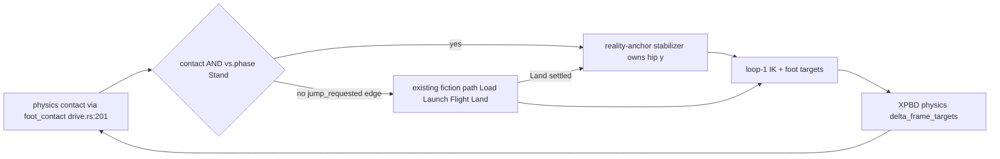

# Vertical Stabilizer for the Walking Phase — design (2026-11-02)

Status: **design agreed, not implemented.** Decisions locked by the user:
1. Gravity is **ignored while grounded** (a stance foot always exists during walk ⇒ the
   ground reaction cancels it ⇒ the next-frame prediction carries no gravity term).
2. **Full reality-anchor**: while grounded + walking, `hip_pos.y`/`hip_vel.y` are set
   entirely from measured reality + a PD correction; the fiction spring keeps authority
   only for the jump path (Load/Launch/Flight/Land).

## 0. The problem, in measured numbers

From the aligned-default baseline (`tools/physics-qa/REPRODUCE.md` recipe, Nov branch;
see `plans/stance-delivery-is-the-brake.md` §12–13):

- both feet report **no contact on 48.9 % of ticks** — the body hops with the gait
  clock still saying "stance" ("ghost stance" fraction identical);
- airborne episodes start **mid-stance**: touchdown makes contact, then the *whole
  body* leaves the floor, 37–123 px of uncommanded rise;
- at all 33 onsets, the fiction vertical velocity `tP3vy` is negative (median −123,
  i.e. "falling") **while the body rises** — the spring integrator is out of phase
  with reality;
- `v_filt` < −20 px/s from t ≈ 6.8 s; backward phases show cmd ≈ +78 vs reality ≈ −31.

Diagnosis (audited): the x side closes its loop on reality (position sync + filtered
measured velocity into the placement law), but the y side syncs **position only**
(`HIP_Y_SYNC`, drive.rs:86) and the spring's damping term
(`regulate_height`, vertical.rs:83) acts on **fiction** velocity. A fiction integrator
whose state reality never sees is, by definition, an open loop: it accumulates
momentum reality doesn't have, and the pin servo `(v_hip − v_c)·dt` then chases it —
negative damping. That is the "wobble to wobble even more" failure mode.

## 1. Why this cannot break the x direction (and *helps* it)

The channels were audited end-to-end:

- `state.hip_pos.x += v * dt` (walk.rs:261) — the hip x-integration never reads any
  y quantity;
- `delta_frame_targets` (state.rs:234) — x and y of the servo delta are independent;
  gravity enters only the y slot (`g_eff·dt²`);
- loop-1 IK / foot targets consume `hip.x` and the gait plan, not `hip.y` dynamics.

So the vertical channel can be replaced freely. But two channels **do** couple height
into x (through physics-legitimate paths), and the bounce was poisoning them ±30 % per
tick:

| Quantity | Formula | nominal h=90 | bounce h=110 | effect of un-stabilized y |
|---|---|---|---|---|
| DCM time constant ω₀ | √(g/h) (placement.rs:69) | 3.30 | 2.98 (−10 %) | deadbeat α, β and the exponential horizon change every tick |
| stride envelope x_max | √((thigh+calf)² − h²) (laws.rs:129) | 53.8 → 45.7 with margin | 34.6 → 29.4 (−36 %) | the reachable forward target shrinks exactly when the body rises |

Holding `h` around the nominal stand height keeps ω₀ and x_max at the constants the
placement law was designed against. The stabilizer is therefore not just compatible
with the x controller — it **restores its assumptions**.

## 2. The controller

While grounded (physics contact) and `vs.phase == Stand`:

```text
h_meas = reality hip height above floor          (y-up; = synced state.hip_pos.y − floor)
v_meas = EMA(−P3.velocity.y, α = dt/(τ+dt))      (flip vello y-down → resolver y-up)
h_ref  = slew-limited reference (config.hip_height, or crouch_height when crouching)

e = h_ref − h_meas
a = Kp·e − Kd·v_meas + a_ff          # a_ff = g·(1 − support_share)·dt/2 feed-forward (see below)
clamp |a| ≤ A_MAX                    # only accelerations the legs can actually produce

h_pred = h_meas + v_meas·dt + ½·a·dt²   # gravity deliberately ABSENT: ground cancels it
v_pred = v_meas + a·dt

state.hip_pos.y = floor + h_pred
state.hip_vel.y = v_pred
```

- **No gravity term** (decision 1): the fiction and the physics pin agree — the pin
  applies `g_eff = (1 − support_share)·g` while stance (state.rs:244), so residual
  sag ≈ 490 px/s² is *measured* on the next tick and corrected; the `a_ff` term
  (≈ +3 px/s per tick) is optional fine-tuning to zero the steady-state bias, worth
  ≤ 0.03 px/tick of position. Ship `a_ff` ON; it is one term.
- The loop state **is** reality (`h_meas`, `v_meas`), so the fiction can never
  accumulate momentum the body doesn't have — this is the structural fix for the
  out-of-phase integrator.
- The fiction hip vel this feeds (`v_hip.y` in the pin servo) now *equals* the
  reality velocity plus the bounded command — the servo stops chasing a ghost, which
  is the energy-pumping path of the bounce.
- While grounded, the stance **plant's own height** is the IK chain's base; with
  `h_ref` held near nominal, leg length always reaches the floor (§1 table).

## 3. Gating and the jump bypass



Three gates:

1. **Contact from physics, not the clock.** Today `vertical.rs:101`
   (`grounded = phase == Stance || …`) is the gait clock — that is what produced the
   ghost stance. The stabilizer runs on `foot_contact` (raw `touching`, already wired
   per tick at drive.rs:201–209 through the `grounded` local at drive.rs:159). A new
   `ResolverState.reality_v` field carries it; `grounded` in vertical.rs:101 switches
   to it (with `None` ⇒ fall back to the clock, preserving the pure-kinematic sandbox
   path and every existing test that drives no contact).
2. **Jump bypass.** The stabilizer only owns the `Stand` branch. `jump_requested`
   fires the usual `Stand → Load` edge; Load/Launch/Flight/Land run the *existing*
   spring + ballistic law unchanged; on `Land → Stand` the stabilizer resumes.
   A/B must prove the jump episode is bit-identical with the switch on.
3. **Airborne = no authority.** With no contact the ground reaction cannot cancel
   gravity and the legs cannot push the CoM: the controller idles, reality is
   ballistic, and the fiction **follows** reality's height (the `HIP_Y_SYNC`
   position-sync behavior is retained as the airborne branch of the stabilizer). No
   free-run — that is the anti-hover guarantee the jump tests already protect
   (`test_design_controller_has_no_airborne_authority`).

The anti-jump property emerges from the math: a rising body ⇒ `e < 0` and `v_meas > 0`
⇒ `a < 0` — the controller commands *down*, capped at `A_MAX` so it never demands an
unreachable press. Squash-to-jump, inverted: **press to stay down.**

## 4. Where it goes in the code

| Piece | Location | Change |
|---|---|---|
| Measured reality y | drive.rs, the `HIP_Y_SYNC` block (86–89) | also compute `v_meas = EMA(−P3.velocity.y)` and write `pin.state.reality_v = Some(RealityVertical { h_meas: pin.state.hip_pos.y − floor, v_meas })` |
| New field | resolver/types.rs `ResolverState` | `reality_v: Option<RealityVertical>` + `LegContactInput` reuse for contact gate |
| The controller | resolver/vertical.rs `tick_vertical` | in `VerticalPhase::Stand`: if `v_stabilize && contact.grounded && reality_v` → reality-anchor; else existing `regulate_height` |
| Clock-based grounded | resolver/vertical.rs:101 | replace with physics contact when `reality_v` present, fallback to clock otherwise |
| Params | hip_pin/params.rs | `V_STABILIZE: bool` default **false**; `V_STAB_KP: 144`, `V_STAB_KD: 24`, `V_STAB_TAU: 0.03`, `V_STAB_SLEW: 100`, `V_STAB_AMAX: 980` |

Constants rationale: ωₙ = √Kp ≈ 12 rad/s (≈ 1.9 Hz — faster than the 0.28 s stance
but far below impact/EMA noise); Kd = 2ζωₙ (ζ = 1); EMA τ = 0.03 s gives phase lag
atan(ωτ) ≈ 20° at ωₙ = 12 (τ = 0.1 s would give 50° and eat the stability margin —
do **not** reuse V_MEAS_TAU=0.6 here); slew 100 px/s keeps commanded-height changes
(crouch) gentle enough for the x_max envelope to track; A_MAX ≈ 1 g so the legs never
demand more than free-fall-equivalent press authority.

## 5. Why this can't collapse (each failure mode has a bound)

- **Walk backwards / stall** (the bounce symptom): plant error was driven by the jump
  modulating x_max and ω₀ (§1); removing the jump restores the constants.
- **Squish too hard** (press the body into the floor): `|a| ≤ A_MAX` and the PD is
  critically damped — it cannot overshoot downward unboundedly, and the floor
  reaction stops the body before the fiction can outrun it (reality is the state).
- **Jump breaks**: Load starts from the *stand height* the stabilizer holds; delta_l
  crouch is computed from `stand` (vertical.rs:140), same as today — only the
  pre-jump height is now guaranteed to be nominal instead of bounce-scattered.
- **Contact flapping** (1-tick dropouts): debounce `grounded` (CONTACT_ON_TICKS=2)
  already lives in `GroundSupport`; use `support.grounded` (debounced) for the gate,
  `touching` stays for the resolver's phase authority as today.

## 6. Validation protocol (all on the aligned baseline, `run_walk.sh`)

A/B: `V_STABILIZE=0` (byte-identical to today) vs `V_STABILIZE=1`, same command,
same asset, 90 Hz fixed clock.

| Metric | today (off) | target (on) |
|---|---|---|
| both-feet-airborne tick fraction | 48.9 % | < 2 % |
| ghost-stance fraction (gait Stance, no contact) | ~ same | < 2 % |
| hip height p-p during walk | 37–123 px | < ±15 px |
| first t where v_filt < −20 px/s | ≈ 6.8 s | never within script |
| worst stance drift | 96 px | materially better |
| jump script episode | works | works, apex within existing test bounds |

Plus: `cargo test` (167+) green; the five new unit tests below; then ship
`V_STABILIZE=1` as the default once the A/B passes (same promotion path as
`HIP_Y_SYNC` and `TD_FLOOR`).

## 7. New tests

1. `test_v_stab_rejects_height_impulse` — feed `reality_v` with rising `h_meas`,
   `v_meas > 0`; assert the fiction commands downward acceleration and the tracked
   band settles within ±15 px in < 0.3 s.
2. `test_v_stab_groundled_prediction_has_no_gravity` — constant `v_meas`, zero error:
   predicted motion is linear, no g·dt² drift accumulates in the fiction.
3. `test_v_stab_bypassed_by_jump` — full jump episode with the switch ON is
   bit-identical through Load/Launch/Flight/Land; only pre-Load Stand differs.
4. `test_v_stab_no_airborne_authority` — with contact off, stabilizer idle,
   ballistic physics preserved (the anti-hover invariant).
5. `test_v_stab_deterministic_and_off_inert` — switch OFF ⇒ byte-identical CSV to
   the committed baseline; switch ON ⇒ same input, same output across runs.

## 8. Explicitly out of scope (parked)

- Swing-delivery shortfall / stance-slide / command sawtooth — the *x-side* loop
  story; this design only guarantees it gets stable ω₀ and x_max to fight with.
- Attitude loop-3 y↔x coupling — real but small; revisit if hip band is met but lean
  still oscillates.
- support_share tuning (0.5 vs 1.0) — secondary: the stabilizer measures the residual
  sag and corrects it, so the parameter stops mattering for height.
